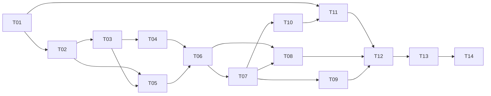

# Code Harness Web Workbench Implementation Plan

> **For agentic workers:** REQUIRED SUB-SKILL: Use superpowers:subagent-driven-development (recommended) or superpowers:executing-plans to implement this plan task-by-task. Steps use checkbox (`- [ ]`) syntax for tracking.

**Goal:** 在现有 codea-harness 仓库交付 Windows 本地可用的 Git 已提交变更 Review 工作台，复用 OpenCode 2.x 原生能力并使用 MySQL。

**Architecture:** React 前端与 TypeScript Harness 同源。Harness 通过 MySQL 事务/Outbox 管理固定代码快照、Task/Run、事件与成果，OpenCode 保持实际 Agent 执行职责。首期单执行槽，未来迁移服务器继续使用 MySQL。

**Tech Stack:** React/TypeScript/Vite、Node.js 22 LTS/Fastify 5、mysql2/promise、MySQL 8.4/InnoDB、锁定公司实测 OpenCode 2.x 客户端；Vitest、Playwright；npm workspaces。

**Spec:** [总体与效果图](../specs/2026-11-02-code-harness-web-workbench-design.md)、[后端规格](../specs/2026-11-02-code-harness-web-backend-design.md)、[OpenAPI](../specs/contracts/2026-11-02-code-harness-web-v1.openapi.yaml)、[DDL](../specs/database/2026-11-02-code-harness-web-mysql-v1.sql)。四份一起交付。

本文交给**人工研发团队**实施；上面的 agentic header 仅供以后使用 AI 工作者时参考。本次只交付方案、契约、SQL 和任务计划，不开始产品实现。

## Global Constraints

- 只新增独立 `web-workbench/`，不得改变旧 Runtime 或 TUI Review/Commit；提交中不混入其他功能。
- 首期 Windows、本地单用户、本地 Git 已提交范围；不自动 fetch/pull，不接 PR、不改码、不 commit/push。
- MySQL 8.4、InnoDB、utf8mb4、UTC DATETIME(3)；不替换成 SQLite；BIGINT 在 API 中是十进制字符串。
- API `/api/v1`、同源、loopback、本机会话/Origin/CSRF；所有业务写动作 operationId 幂等。
- 一个 Task 一个固定 scope/root Session；Run.kind=`REVIEW|DISCUSS|RECHECK`；重试用 retryOfRunId；每 Task 一个活动 Run、全局一个执行槽、排队最多 20。
- 预览 300 秒；notes 2,000 字、追问 8,000 字、quote 4,000 字；Controller `^[A-Za-z_][A-Za-z0-9_]*$`，最长 128。
- 所有未核实原生受理进入 RECOVERING，不自动重复派发；租约过期不是重跑依据。
- 原生固定报告 `temp/codea-review-report.md`，五章 Markdown、HIGH/MEDIUM；每 Run 单独归档；DISCUSS 不要求重写报告。
- 页面完全沿用确认效果图；阶段、权限与结果来自真实事件；没有模型接通时必须标为模拟或不可用。
- 测试命令均为**未来研发验收指令**，不代表本次已执行；真实 MySQL/Windows/公司模型测试不得用 mock 结果代替。

## Review Focus

- 中文/空格/大小写目录、junction 与隐藏执行指令：T03/T04 必须保真或拒绝，源仓库字节不变。
- 双击、同号不同参数、发送后进程崩溃：T05/T06 必须不重复创建 Task 或盲发模型。
- 停止与原生完成竞争、权限多请求/过期/丢应答：T06/T09 必须依据实际终态，不能假停止/假授权。
- 旧报告残留、write 失败、无适用业务变更：T03/T10 必须明确失败/边界，不能借旧文件成功。
- SSE 查询与订阅竞态、断线无日志、跨 Task 路径或恶意 Markdown：T07/T10/T11 必须补齐或显示缺失，拒绝越界和脚本执行。

---

## 1. 分工、阶段与依赖

角色按能力分配，具体姓名由研发负责人填入：BE1 负责数据/Git/业务 API；BE2 负责 OpenCode/调度/恢复；FE 负责页面；QA 负责验收；Release 负责 Windows 打包，可兼职。T01 由 BE2 牵头，不要求五人全职。

| Task | 责任角色 | 依赖 | 可验收交付 | 估算人日 |
| --- | --- | --- | --- | ---: |
| T01 真实能力探针与工程契约 | BE2/BE1 | 无 | 公司构建矩阵、客户端锁版、契约生成可用 | 3–4 |
| T02 MySQL/迁移/本机会话 | BE1 | T01 | 空库迁移、健康与鉴权 | 2–3 |
| T03 仓库登记与范围预览 | BE1 | T02 | 只读 Git API、范围预检 | 1.5–2 |
| T04 固定代码副本与证据读取 | BE1 | T03 | 独立快照、manifest、源码接口 | 3–4 |
| T05 Task/Run/幂等 API | BE1 | T02/T03 | 创建/历史/操作查询、单 Task 并发约束 | 2–3 |
| T06 调度/原生执行/停止恢复 | BE2 | T01/T02/T04/T05 | 单槽执行、真实中断与不明受理恢复 | 2–3 |
| T07 持久事件与 SSE | BE2 | T02/T05；T06 联调 | 自有 seq/replay/对账 | 1.5–2.5 |
| T08 追问/复查/失败重试 | BE1/BE2 | T05/T06/T07 | 串行轮次、固定范围复用 | 1–2 |
| T09 原生权限/表单 | BE2 | T06/T07 | 一次允许/拒绝、有效性校验 | 1.5–2 |
| T10 报告归档与读取 | BE1 | T04/T06/T07 | 本轮报告证据、安全下载 | 1.5–2 |
| T11 页面主路径与源码证据 | FE | T01 契约可 mock；真实联调 T03/T05/T07/T10 | 已确认四页与固定版本代码抽屉 | 2–3 |
| T12 页面交互/异常/恢复 | FE | T08/T09/T11 | 追问/权限/停止/刷新恢复 | 1.5–2.5 |
| T13 集成与故障验收 | QA/两后端/FE | T04–T12 | 故障矩阵/真实回归/证据 | 1.5–2.5 |
| T14 Windows 运行包与交接 | Release/QA | T13 | 干净机运行、迁移与备份恢复说明 | 1–1.5 |

合计约 **25–37 人日**，3–5 周日历估算依赖并行人员和公司能力接通。T01 完成后重新估算。前端 T11 可按契约先行，T06 的模拟端口可先写测试；未经 T01 真实验证不得宣称打通。



里程碑 M0=T01–T02；M1=真实首轮 Review+报告（T03–T07/T10/T11）；M2=交互与可靠性（T08/T09/T12/T13）；M3=Windows 包（T14）。关键路径是能力验证→固定副本→真实执行→恢复/报告→整体验收；不按页面张数估算后端工作。

## 2. 文件结构与共享类型

以下路径均相对仓库根，未存在的是待研发创建；无需在旧工程根新增一套 package.json。

```text
web-workbench/
  package.json / package-lock.json / tsconfig.base.json
  apps/server/src/{app.ts,config.ts,auth.ts}
  apps/server/src/modules/{repositories,previews,tasks,runs,messages,interactions,artifacts,events}/
  apps/server/src/workers/{scheduler,reconciler,event-collector,report-collector}.ts
  apps/web/src/{app.tsx,api/client.ts,api/events.ts,pages/,components/}
  packages/contracts/{src/api.generated.ts,src/domain.ts,src/events.ts,src/ports.ts}
  packages/storage/{migrations/001_init.sql,src/{db,operations,events,runs,slots}.ts}
  packages/git-provider/src/{repository,preview,snapshot,files}.ts
  packages/opencode-adapter/src/{adapter,probe,mapping}.ts
  scenarios/code-review/{scenario.json,context.ts,report.ts}
  scripts/windows/{start.ps1,diagnose.ps1}
  tests/{capabilities,mysql,git,api,workers,events,reports,ui,acceptance}/
  docs/{capability-matrix,windows-runbook,backup-restore}.md
```

T01 在 contracts 定义下面**自有 port**，非 SDK 同名承诺。公开 DTO 由 OpenAPI 生成，不手写第二份字段。

```typescript
type UUID = string;
type Seq = string;
type DTO<K extends keyof components['schemas']> = components['schemas'][K];
type Tx = PoolConnection; // mysql2/promise，仅 storage/服务内部使用
type Lease = { slotKey: 'local-default'; runId: UUID; owner: string; fence: Seq };
type ScopeSelection = { repositoryId: UUID; baseRefId: string };
type Snapshot = { taskId: UUID; scope: DTO<'Scope'>; storageKey: string; manifestHash: string };
type SessionBinding = { taskId: UUID; serviceIdentity: string; sessionId: string; locationKey: string };
type NativeInspection = { active: boolean | 'UNKNOWN'; pendingInputs: number | 'UNKNOWN';
  pendingInteractions: number | 'UNKNOWN'; acceptedInputIds: string[]; externalMutation: boolean };
type NativeAcceptance = { state: 'ACCEPTED' | 'REJECTED' | 'UNKNOWN'; inputId?: string };
type NativeEnvelope = { sourceId?: string; cursor?: string; taskId: UUID; runId: UUID;
  type: DTO<'Event'>['type']; data: Record<string, unknown> };
interface OpenCodeAdapter {
  probe(): Promise<DTO<'Capability'>[]>;
  createSession(taskId: UUID, snapshot: Snapshot): Promise<SessionBinding>;
  putContext(binding: SessionBinding, context: { scope: DTO<'Scope'>; notes?: string }): Promise<void>;
  startReview(binding: SessionBinding, input: { runId: UUID; controller?: string }): Promise<NativeAcceptance>;
  discuss(binding: SessionBinding, input: { runId: UUID; messageId: UUID; text: string }): Promise<NativeAcceptance>;
  inspect(binding: SessionBinding): Promise<NativeInspection>;
  readMessages(binding: SessionBinding, cursor?: string): Promise<{ items: DTO<'Message'>[]; nextCursor: string | null }>;
  subscribe(binding: SessionBinding, cursor?: string): AsyncIterable<NativeEnvelope>;
  interrupt(binding: SessionBinding): Promise<{ responseReceived: boolean; interrupted?: boolean }>;
  listInteractions(binding: SessionBinding): Promise<DTO<'Interaction'>[]>;
  answer(binding: SessionBinding, nativeRequestId: string, answer: DTO<'AnswerRequest'>['answer']): Promise<NativeAcceptance>;
}
```

原生数据至业务 ID 映射由 Adapter/绑定存储负责，不能用 native ID 冒充 UUID；端口返回 UNKNOWN 是正常分支。后文函数均使用上述类型；所有查询需 ownerId，内部 worker 用 Lease 并验证 task 绑定。

## T01：真实能力探针与工程契约

**责任：BE2；文件：** Create `web-workbench/package.json`、lock、tsconfig；`packages/contracts/src/{api.generated,domain,events,ports}.ts`；`packages/opencode-adapter/src/{probe,mapping}.ts`；`tests/capabilities/probe.test.ts`；`docs/capability-matrix.md`。

**Interfaces：** Consumes 四份设计及公司构建；Produces 上述类型和 `probe(): Promise<DTO<'Capability'>[]>`，`api.generated.ts` 从 YAML 生成；固定 command/context/forms/permission/interrupt/log 的实际调用和降级。

- [ ] 写 `probe.test.ts`：missing command/skill/permission 为不可执行；缺 instruction 禁用 notes；缺 log 可 GAP 降级；公司模型不可用不 READY。
- [ ] 从 `web-workbench/` 运行 `npm test -- tests/capabilities/probe.test.ts`，期望初次因 probe 未实现失败。首次配置 Vitest 同时提供 `npm run typecheck`、`npm run test:mysql`、`npm run test:e2e`、`npm run test:windows-smoke` 脚本。
- [ ] 实现 probe/mapping/port，锁客户端版本；生成 DTO，实际完成公司 Windows 单轮 command→skill→权限→报告→prompt→interrupt，不运行旧 Go Runtime。
- [ ] 运行上述测试和 `npm run typecheck`；保存 build、客户端、模型别名、资源 digest、各能力实测记录（无密钥）。缺必需能力 M0 阻断，不能把 UNKNOWN 改为支持。
- [ ] 提交：`feat(workbench): establish native capability and API contracts`，只含本 Task 文件。

## T02：MySQL 迁移、存储与本机会话

**责任：BE1；文件：** Create `packages/storage/migrations/001_init.sql`（从设计 DDL 转换）；`packages/storage/src/db.ts`；`apps/server/src/{app,config,auth}.ts`；`tests/mysql/schema.test.ts`、`tests/api/auth.test.ts`。

**Interfaces：** Consumes T01 DTO/Tx；Produces `withTransaction<T>(fn:(tx:Tx)=>Promise<T>):Promise<T>`、`requireOwner(request):Promise<UUID>`、`createApp(config):Promise<FastifyInstance>`；health/auth/bootstrap 按 OpenAPI。

- [ ] 写测试：空库 14 表/外键/CHECK/unique；两个活动 Run 同 Task 第二条失败；错误 OID/跨 Task 引用由服务或 FK 拒绝；BIGINT=9007199254740993 往返不失真；错误 Origin/缺 CSRF 拒绝；配对码一次消费/5 分钟到期。
- [ ] 运行 `npm run test:mysql -- tests/mysql/schema.test.ts` 与 `npm test -- tests/api/auth.test.ts`，期望迁移/鉴权未实现失败；只连测试专库。
- [ ] 实现参数化 SQL/UTC/池连接/迁移锁与 checksum、会话和引导；健康不泄漏 DSN。迁移失败不得静默启动；不在业务进程使用 DDL 高权限账号。
- [ ] 重跑两组测试、`npm run typecheck`；MySQL 8.4 实机输出归档，不能用 SQLite 或内存替身证明迁移通过。
- [ ] 提交：`feat(workbench): add mysql storage and local authentication`。

## T03：仓库登记与范围预览

**责任：BE1；文件：** Create `packages/git-provider/src/{repository,preview}.ts`；`apps/server/src/modules/{repositories,previews}/routes.ts`；`tests/git/preview.test.ts`、`tests/api/repositories.test.ts`。

**Interfaces：** Consumes T02 owner/事务；Produces `registerRepository(ownerId,input:DTO<'RegisterRepository'>):Promise<DTO<'Repository'>>`、`listRefs(ownerId,repositoryId):Promise<DTO<'Refs'>>`、`createPreview(ownerId,input:DTO<'PreviewRequest'>):Promise<DTO<'Preview'>>`。

- [ ] 写 fixture 测试：中文/空格路径、同名 ref、detached HEAD、无共同祖先、无差异、SQL-only 可分析；dirty 内容仅显示未纳入数；不支持 partial/LFS/子模块时明确错误；预览 300 秒。
- [ ] 运行 `npm test -- tests/git/preview.test.ts tests/api/repositories.test.ts`，期望缺服务失败。
- [ ] 实现真实 Git argv、签名 refId、可信根/realpath、只读预检、operation 幂等；禁止自动联网；复用原生适用文件筛选而非仅匹配 Java。
- [ ] 重跑上述测试；记录源 HEAD/index/worktree 指纹前后相同；`$()`/`;`/中文 Controller 拒绝，合法类名通过。
- [ ] 提交：`feat(workbench): validate local repositories and review previews`。

## T04：固定副本与源码证据

**责任：BE1；文件：** Create `packages/git-provider/src/{snapshot,files}.ts`；`apps/server/src/modules/tasks/files.ts`；`tests/git/snapshot.test.ts`、`tests/api/files.test.ts`。

**Interfaces：** Consumes Preview/Task；Produces `prepareSnapshot(taskId:UUID,preview:DTO<'Preview'>):Promise<Snapshot>`、`listFiles(ownerId,taskId):Promise<DTO<'FileList'>>`、`readFileLines(ownerId,taskId,fileId,startLine?,endLine?):Promise<DTO<'FileLines'>>`。

- [ ] 写测试：副本对象无 hardlink/alternates；hooks/filter 不运行；控制指令、敏感文件不可浏览；junction/逃逸拒绝；分析期间源变更仍指向旧 OID；删除文件可读 BASE；500 行上限、空文件、安全文件 ID。
- [ ] 运行 `npm test -- tests/git/snapshot.test.ts tests/api/files.test.ts`，期望未实现失败。
- [ ] 实现对象复制/验证、显式物化、固定 base alias、manifest/预算、partial→rename、Snapshot READY；文件 ID绑定 side/path/blob。不 checkout 原仓库；控制文件排除写覆盖说明。
- [ ] 重跑测试并在 Windows Git 实测中文路径、大小写/符号链接；源仓库指纹不变；5 GiB/50,000 文件预算超限明确失败，不截断冒充成功。
- [ ] 提交：`feat(workbench): build immutable review snapshots and file evidence`。

## T05：任务、轮次与幂等 API

**责任：BE1；文件：** Create `apps/server/src/modules/tasks/{service,routes}.ts`；`packages/storage/src/{operations,runs}.ts`；`tests/api/tasks.test.ts`、`tests/mysql/idempotency.test.ts`。

**Interfaces：** Consumes Preview/T02；Produces `createTask(ownerId,input:DTO<'CreateTask'>):Promise<DTO<'Operation'>>`、`getTask(ownerId,taskId):Promise<DTO<'TaskDetail'>>`、`getOperation(ownerId,operationId):Promise<DTO<'Operation'>>`；Task/Run 列表按契约。

- [ ] 写并发测试：相同 operation 50 次只一 Task/Run/Outbox；同号异参409；不同号同preview409；HEAD/base变更409；过期409；notes不支持422；第21项队列拒绝（活动Run另计）；不同owner404。
- [ ] 运行 `npm run test:mysql -- tests/mysql/idempotency.test.ts` 和 `npm test -- tests/api/tasks.test.ts`，期望任务事务未实现失败。
- [ ] 实现短事务创建及序列计数；重复结果稳定；轮次 status 由最新Run派生；保存 operation result，不把 HTTP 超时当新任务。
- [ ] 重跑测试，断开提交后 HTTP 响应后用 operationId 找到原Task；校验游标签名/owner/filter绑定。
- [ ] 提交：`feat(workbench): persist tasks runs and idempotent operations`。

## T06：执行调度、停止与恢复

**责任：BE2；文件：** Create `apps/server/src/workers/{scheduler,reconciler}.ts`；`packages/storage/src/slots.ts`；`packages/opencode-adapter/src/adapter.ts`；`apps/server/src/modules/runs/stop.ts`；`tests/workers/dispatch.test.ts`、`tests/mysql/lease.test.ts`。

**Interfaces：** Consumes T01 Adapter、T04 Snapshot、T05 Outbox；Produces `dispatchNext(workerId:string):Promise<UUID|null>`、`reconcile(runId:UUID):Promise<void>`、`requestStop(ownerId,runId,input:DTO<'OperationRequest'>):Promise<DTO<'Operation'>>`。所有 worker 落盘校验 Lease。

- [ ] 写测试：全局最多一个执行；10秒续租/30秒过期；旧 fence 禁止写；SENDING后崩溃只RECOVERING不重发；排队取消不建Session；interrupt=false与完成竞争不假STOPPED；inbox未清不得释放槽。
- [ ] 运行 `npm test -- tests/workers/dispatch.test.ts`、`npm run test:mysql -- tests/mysql/lease.test.ts`，期望未实现失败。
- [ ] 实现领取事务/可信Session/固定command、出站状态、unknown恢复、软超时与中断；不为模型发起配置通用自动重试；恢复先验证 service identity 和活动输入。
- [ ] 重跑并注入发前/发后崩溃、MySQL断线、睡眠唤醒；用 T01 真服务证明中断与待处理表单清理实际生效。外部TUI写入本Task需RECOVERING。
- [ ] 提交：`feat(workbench): schedule native runs with fenced recovery`。

## T07：持久事件和 SSE

**责任：BE2；文件：** Create `packages/storage/src/events.ts`；`apps/server/src/workers/event-collector.ts`；`apps/server/src/modules/events/routes.ts`；`tests/events/replay.test.ts`。

**Interfaces：** Consumes NativeEnvelope/Lease/Tx；Produces `appendEvent(tx:Tx,event:Omit<DTO<'Event'>,'seq'>,dedupeKey?:string):Promise<Seq>`、`streamEvents(ownerId,taskId,after:Seq):AsyncIterable<DTO<'Event'>>`；native cursor 单独保存。

- [ ] 写测试：并发 seq唯一单调；去重无重复；事务回滚不广播；查询/监听缝隙不丢；Last-Event-ID优先；超前cursor409；native无log标GAP；100ms/4KiB合批且完整消息替换临时文本。
- [ ] 运行 `npm test -- tests/events/replay.test.ts`，期望未实现失败。
- [ ] 实现 Task 行锁分配seq、commit后唤醒、2秒DB兜底/15秒心跳、500条分页重放，单owner5连接；不能靠进程内 EventEmitter 充当持久日志。
- [ ] 重跑测试及数据库集成；浏览器断线重连/服务重启保持去重和终态；日志缺失明确展示。
- [ ] 提交：`feat(workbench): replay durable task events over sse`。

## T08：追问、复查与重试

**责任：BE1/BE2；文件：** Create `apps/server/src/modules/messages/{service,routes}.ts`、`apps/server/src/modules/runs/continue.ts`；`tests/api/continuations.test.ts`。

**Interfaces：** Consumes Adapter/TaskService/事务；Produces `sendMessage(ownerId,taskId,input:DTO<'DiscussionRequest'>):Promise<DTO<'Operation'>>`、`recheck(ownerId,taskId,input:DTO<'OperationRequest'>):Promise<DTO<'Operation'>>`、`retryRun(ownerId,runId,input:DTO<'OperationRequest'>):Promise<DTO<'Operation'>>`。

- [ ] 写测试：活动轮次409；DISCUSS无新报告可成功；RECHECK新报告版本；重试同kind+retryOfRunId；只能重试最新失败/停止Run且原生真正空闲；引入新分支/路径的追问不能切换scope；报告引用须同Task。
- [ ] 运行 `npm test -- tests/api/continuations.test.ts`，期望继续执行未实现失败。
- [ ] 实现新Run+用户Message+Outbox事务，保留原Task/Session/Snapshot；8,000字限制；quote单独分界，不塞入command参数。
- [ ] 重跑测试与MySQL单Task竞争测试；DISCUSS失败重试保持原用户消息绑定，不制造两条有效相同输入。
- [ ] 提交：`feat(workbench): add scoped discussion recheck and retries`。

## T09：原生权限与补充表单

**责任：BE2；文件：** Create `apps/server/src/modules/interactions/{service,routes}.ts`；`tests/api/interactions.test.ts`。

**Interfaces：** Consumes Adapter/Interaction DTO/Lease；Produces `answerInteraction(ownerId,interactionId,input:DTO<'AnswerRequest'>):Promise<DTO<'Operation'>>`；GET仅当前轮次未解决请求。

- [ ] 写测试：allow-once不变成全局；revision不符/过期/已处理/跨Task409或404；普通聊天不能授权；两个待处理请求解决一个仍WAITING；答案发送丢应答UNKNOWN仅对账；不支持schema不能假装成功。
- [ ] 运行 `npm test -- tests/api/interactions.test.ts`，期望未实现失败。
- [ ] 实现本轮原生ID映射、15分钟期限、ANSWER outbox、有限表单类型和取消；排除“始终允许Shell”。
- [ ] 重跑测试，用实际Git ask、拒绝、补充表单验证平台与原生两侧状态一致。
- [ ] 提交：`feat(workbench): resolve native permissions and forms safely`。

## T10：报告归档与安全读取

**责任：BE1；文件：** Create `apps/server/src/workers/report-collector.ts`；`apps/server/src/modules/artifacts/{service,routes}.ts`；`scenarios/code-review/{scenario.json,context.ts,report.ts}`；`tests/reports/collect.test.ts`。

**Interfaces：** Consumes Lease/本轮write evidence/Snapshot；Produces `collectReport(lease:Lease):Promise<DTO<'ArtifactSummary'>>`、`getArtifact(ownerId,artifactId):Promise<DTO<'Artifact'>>`；下载返回验证后的受控文件流。

- [ ] 写测试：旧文件、模型仅声称写入、不同会话write、缺五章、写失败、超过2MiB均不成功；PARTIAL如实保留；归档后DB失败可幂等登记；复查失败不覆盖旧报告；哈希变化拒绝下载。
- [ ] 运行 `npm test -- tests/reports/collect.test.ts`，期望Collector未实现失败。
- [ ] 实现固定路径读取、开始前移除旧候选、原子归档、hash/version、DB事件事务；不能解析任意Markdown伪造Finding计数。
- [ ] 重跑测试并以原生模板真实产物验收五章/HIGH/MEDIUM/SQL-only；文件越界和跨owner下载返回拒绝。
- [ ] 提交：`feat(workbench): archive verified per-run review reports`。

## T11：页面主路径与固定版本证据

**责任：FE；文件：** Create `apps/web/src/{app.tsx,api/client.ts,api/events.ts,pages/workbench.tsx,pages/task-detail.tsx,components/report.tsx,components/source-view.tsx}`；`tests/ui/review.spec.ts`。

**Interfaces：** Consumes OpenAPI生成DTO、四图与现有HTML原型；Produces 工作台→范围预览→任务详情→报告→源码抽屉；`openTask(taskId:UUID):void` 为页面导航边界。

- [ ] 写Playwright断言：本地Git/基线表单、dirty提示；版本变化必须重新预览；点击超时按原operation查询；历史固定SHA；报告引用读快照BASE/HEAD行；390px/1488px无横向表单溢出。
- [ ] 运行 `npm run test:e2e -- tests/ui/review.spec.ts`，期望页面未实现失败；mock需显式标识，不能作为真实接通证据。
- [ ] 按确认布局实现，安全Markdown、无原始HTML、限定链接协议、代码块不执行；原型计时器/假报告换真实API。非READY禁用并展示原因，不显示其他假场景卡。
- [ ] 重跑E2E并接真实后端；注入 script/javascript链接/恶意文件名验证不会执行或逃逸。
- [ ] 提交：`feat(workbench): implement the approved review workbench pages`。

## T12：页面权限、追问、停止与刷新恢复

**责任：FE；文件：** Create `apps/web/src/components/{interaction-panel,discussion,run-controls,connection-banner}.tsx`；Modify `api/events.ts`、`pages/task-detail.tsx`；Create `tests/ui/interactions.spec.ts`。

**Interfaces：** Consumes T07–T11；Produces `applyTaskEvent(event:DTO<'Event'>):void`（以seq去重）；权限/表单专用UI；当前轮次活动时草稿保留但禁止普通追问。

- [ ] 写E2E：允许/拒绝、表单旧revision、正在停止非已停止、DONE竞争；刷新恢复lastSeq/完整消息；会话失效重配对不重建任务；无log显示记录缺失；新代码须新Task。
- [ ] 运行 `npm run test:e2e -- tests/ui/interactions.spec.ts`，期望组件未实现失败。
- [ ] 实现原生专用交互、notes能力降级、操作幂等号持久至完成、连接状态、失败可操作原因；message.completed替换临时delta，控制字符仅安全文本显示。
- [ ] 重跑真实后端E2E；浏览器关闭不停止原任务，恢复后能看报告/继续追问；禁止UI擅自全局授权。
- [ ] 提交：`feat(workbench): complete review interactions and reconnect flows`。

## T13：整合与故障验收

**责任：QA牵头；文件：** Create `tests/acceptance/{mysql-recovery,windows-native}.test.ts`、`docs/acceptance-matrix.md`；必要修复留在所属组件。

**Interfaces：** Consumes T01–T12；Produces 每例“构建/前置/输入/操作/预期/实际/证据/结果”的记录，禁止只写总体通过。

- [ ] 先为集成缝隙写可失败断言：dispatch发送瞬间杀服务、DB提交后丢应答、接管旧fence、复查残留报告、SSE断点、原生外部写入、停止挂起输入；为每个失败复现记录问题。
- [ ] 运行 `npm run test:mysql`、`npm run test:e2e`、`npm run typecheck`；存在缺口先保留红色证据，不改成跳过测试。
- [ ] 在组件内修复，覆盖主方案17.1全部15类用例；受控替身证明确定性，实际公司模型至少走一次授权→报告→追问→复查→停止。对原仓库前后作指纹比较。
- [ ] 重跑受影响测试和完整发布门禁，归档矩阵；未验证MySQL/Windows/OpenCode任一项则不得标M2完成。
- [ ] 提交：`test(workbench): verify native execution and crash recovery`。

## T14：Windows 包与研发交接

**责任：Release/QA；文件：** Create `scripts/windows/{start,diagnose}.ps1`、`docs/{windows-runbook,backup-restore}.md`、`.github/workflows/workbench-windows.yml`；包不包含公司密钥、任务代码或node_modules源码快照。

**Interfaces：** Consumes M2；Produces 独立Web运行包、锁定依赖manifest、迁移checksum、启动/停止/备份/恢复操作说明。

- [ ] 写 `tests/acceptance/package.test.ts`：中文/空格安装目录、MySQL缺失/错误密码/证书、端口冲突、资产缺失给出可操作错误；退出不杀共享OpenCode；升级不覆盖task目录和本机凭据。
- [ ] 运行 `npm test -- tests/acceptance/package.test.ts`，期望启动/打包未实现失败。
- [ ] 实现预检→迁移状态检查→服务启动→浏览器打开。迁移由管理员明确运行并备份，应用不静默改库。干净Windows依赖缺项一次列明，不运行时下载安装。
- [ ] 在Windows执行 `npm run test:windows-smoke`；以测试库备份+数据目录校验恢复一次，历史只读与原生Session不可续接情况明确。保存构建号与验收记录。
- [ ] 提交：`build(workbench): package the verified windows workbench`；研发自行发开发PR，验收后再安排发布。

## 3. 自审与交接标准

已按总体方案1–19节、后端规格1–9节核对任务覆盖：页面=T11/12；Git固定范围=T03/04；原生适配=T01/06/09；状态/幂等=T05/06/08；数据=T02；事件=T07；成果=T10；Windows/迁移=T14；异常总验收=T13。未覆盖的服务器多用户/PR/自动改码明确不属于首期，不隐含在当前工期。

每个Task只有在自己的测试和契约通过后完成；一次合并不得以“页面可点”代替后端验收。公共DTO改动同步OpenAPI，迁移修改必须保留已有checksum并加新版本，旧数据升级另写测试。研发负责人在Task表补姓名、实际工期、PR和证据链接即可跟踪。

最终交接：源码分支/PR、Windows包、MySQL迁移、环境项模板（无秘密）、OpenAPI、四页截图、能力矩阵、测试矩阵、运行/备份恢复说明、已知限制。当前文档交付不等于上述产品已开发完成。
