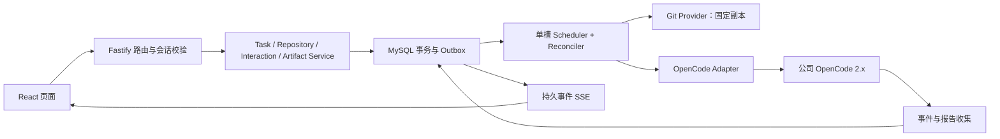

# Code Harness Web：后端、接口与 MySQL 研发规格 v1.0

日期：2026-11-02。状态：供研发实施的设计，尚无产品后端或数据库实机验收。用户已确认页面方向、Windows 本地先行及 MySQL；本文固定首期工程边界。实际公司 OpenCode 的可用能力必须通过任务 T01 验证。

## 1. 研发从这里开始

| 交付物 | 用途 |
| --- | --- |
| [总体方案与四张效果图](2026-11-02-code-harness-web-workbench-design.md) | 产品范围、页面与执行约束 |
| 本文 | 服务设计、接口行为、表字典、事务与恢复 |
| [OpenAPI 3.1 契约](contracts/2026-11-02-code-harness-web-v1.openapi.yaml) | 全部 HTTP 路径、参数、响应与错误；前后端联调依据 |
| [MySQL DDL 草案](database/2026-11-02-code-harness-web-mysql-v1.sql) | 14 张业务表、索引、外键与约束；研发转成版本化迁移后执行 |
| [任务与验收计划](../plans/2026-11-02-code-harness-web-workbench.md) | 负责人角色、依赖、文件、接口、测试与开发顺序 |

冲突处理：字段、必填、枚举以 OpenAPI/DDL 的对应层为准，状态与事务语义以本文为准；发现冲突必须同步修改契约和测试后再实现。不能由某个开发在一侧默默变更。效果图只决定视觉，不覆盖真实状态和权限。

## 2. 技术方案与运行方式

- 模块放在已有 `codea-harness/web-workbench/`，不改旧 Go Runtime，不改原生 TUI 命令语义。
- Web：React + TypeScript + Vite；复用已确认页面；TanStack Query 管理请求和快照；Markdown 关闭原始 HTML，使用协议白名单与消毒。浏览器不直连 OpenCode。
- 服务：Node.js 22 LTS（具体补丁在 T01 锁定）+ TypeScript + Fastify 5；业务路由 `/api/v1`；静态页面同源。一个服务进程内包含 API、事件收集器、调度器和恢复器，不引入 Redis/MQ/微服务。
- 数据：**MySQL 8.4、InnoDB、utf8mb4**。使用 `mysql2/promise` 参数化 SQL、显式事务和版本化 SQL 迁移；避免为了首版引入多套 ORM。其他 MySQL 版本先跑完整迁移与并发测试，不能宣称自动兼容。
- OpenCode：固定公司实测 2.x 二进制、生成客户端和能力摘要；优先复用现有服务。所有原生调用收口于 Adapter。目标公开源码 v2.0.27 只是验证参考。
- 文件：代码副本和成果留在 `%LOCALAPPDATA%\CodeHarness\Workbench\tasks\`。MySQL 存元数据、事件和消息；不把 Git 对象、仓库源码、报告大文件塞入数据库。
- 首期一个 owner、一个执行槽；配置保留 owner 和 service identity。上服务器继续用 MySQL，补公司身份、目录/执行隔离和成果对象存储。

Windows 额外前置条件是可连接的 MySQL 8.4：可在本机装服务，也可配置公司允许访问的开发实例。不默认要求 Docker，不悄悄安装 MySQL，不使用业务生产库。创建独立空数据库，由迁移账号建表，应用账号仅授予该库的 SELECT/INSERT/UPDATE/DELETE。不得给应用 root 或管理其他库权限。

配置：`HARNESS_DATA_DIR`、`HARNESS_HTTP_PORT`（默认 4176）、`HARNESS_MYSQL_HOST/PORT/DATABASE/USER/PASSWORD`、`HARNESS_MYSQL_TLS_CA`、`HARNESS_OPENCODE_CONFIG`（受控配置文件路径）、`HARNESS_REPOSITORY_ROOTS`。密码来自环境或 Windows Credential Manager；诊断只输出连接结果，不回显连接串。远程数据库按公司要求校验证书；不得为省事关闭 TLS 校验。

发布包锁定 Node、依赖、OpenCode 能力、SQL migration checksum；MySQL 用户数据目录由数据库服务负责，不能画成应用目录内一个 `.sqlite` 文件。

## 3. 后端职责与接口层次



| 单元 | 输入/输出与责任 |
| --- | --- |
| RepositoryService | 本机路径→登记仓库；枚举 ref；不联网、不启动模型 |
| PreviewService | repositoryId + opaque baseRefId→5 分钟预览；固定 OID、显示未纳入数量、无适用变更拒绝 |
| TaskService | previewId + operationId→Task + 首轮 Run + Outbox；历史、追问、复查、重试、停止 |
| Scheduler | 槽位/Run 行锁、fence、发起与恢复；不把网络调用包在数据库事务内 |
| OpenCodeAdapter | 可信 Session 绑定、native command/prompt、原生权限/表单、中断与对账 |
| EventCollector | 合并/去重 native 事件；完整消息存库；不采集模型私有推理链 |
| ReportCollector | 验证本轮 write 与五章 Markdown，原子归档，登记 Artifact |
| InteractionService | 匹配当前轮次原生请求；一次回答/拒绝、过期、状态不明核对 |

浏览器参数不得包括 cwd、native sessionID、模型密钥、OpenCode URL、Shell、插件路径。路径只在本地仓库登记时输入，并限制可信根；普通任务只用已授权 ID。

## 4. HTTP 通用约定

- JSON camelCase；DB snake_case；ID 为小写 UUID v4。OID 是 40 或 64 位小写十六进制，必须与记录的 sha1/sha256 格式相符。所有时间为 UTC ISO 8601；DB 使用 UTC DATETIME(3)。BIGINT/业务序列通过 JSON 字符串传输，不能转 JavaScript Number。
- 除健康/登录引导外均要求本机会话。启动时终端显示一次性 pairing code（随机 256 bit、5 分钟、内存中哈希保存、单次消费、每分钟最多 5 次尝试），手动输入后换取 HttpOnly/SameSite=Strict cookie。HTTP 仅允许 loopback；服务器阶段 HTTPS cookie 加 Secure。会话 12 小时，失效只断开页面，不重复执行任务。
- `POST /auth/session` 引导不需要 CSRF，但必须校验准确 Origin 和 loopback Host。所有其他 POST 携带 `X-CSRF-Token`，由 `GET /bootstrap` 获取；仅允许实际同源 Origin，不使用 `*` CORS。配对码不出现在 URL/日志；退出失效 cookie 和 CSRF。第三方网页不能借 localhost 操作任务。
- 所有业务写请求携带 `operationId`，UUID v4；唯一 `(owner_id, operation_key)`。对 action、路由目标和规范化 body 计算 SHA256；相同号相同内容返回原 operation，相同号不同内容 `409 OPERATION_CONFLICT`。操作记录首版不自动删除。
- 同步资源创建返回 201；任务/交互/停止受理返回 202，只代表已持久化受理。统一 `{data, requestId}`；错误 `{error:{code,message,retryable,details},requestId}`，不返回堆栈/密钥/任意文件。
- 列表默认 20、最多 100；cursor 为服务端签名的 `(createdAt,id,filters,owner)` opaque 游标，按 createdAt DESC,id DESC。筛选变化后重置，禁止任意 SQL sort。
- 归属由服务端会话推导；任何 Task/Run/Artifact/Interaction 等跨 owner ID 均 404，不暴露存在性。ID 是定位符，不是授权凭证。
- JSON 请求上限 32 KiB，补充要求最多 2,000 Unicode code point，追问 8,000，引用 4,000，标题 160；Fastify schema 与业务校验统一。原生请求 ID 最长 128；超出时返回能力不兼容，不截断。

### 4.1 接口清单

所有下列路径加前缀 `/api/v1`。完整字段参见 OpenAPI，不能只照此表写空壳。

| 方法/路径 | 请求关键参数 | 结果 / 主要错误 | 任务 |
| --- | --- | --- | --- |
| GET `/health` | 无 | 数据库/原生探针健康，降级 503；不泄漏配置 | T01/T02 |
| POST `/auth/session` | pairingCode | 会话与 CSRF；401/429 | T02 |
| DELETE `/auth/session` | CSRF header | 204 | T02 |
| GET `/bootstrap` | 会话 | owner、场景、限额、已验证能力 | T02 |
| GET `/repositories` | limit,cursor | 获准仓库页 | T03 |
| POST `/repositories` | operationId,name,path | 201 仓库；403 ROOT_NOT_ALLOWED | T03 |
| GET `/repositories/{repositoryId}/refs` | ID | opaque refId、完整 ref、OID、当前 HEAD；只读 | T03 |
| POST `/review-previews` | operationId,repositoryId,baseRefId | 201 preview；无差异/无适用文件 422 | T03 |
| POST `/tasks` | operationId,previewId,title?,controller?,notes? | 202 operation；范围已变化/过期/使用过 409 | T05 |
| GET `/operations/{operationId}` | owner 范围内操作号 | 原 Task/Run 与异步结果；未受理 404 | T05 |
| GET `/tasks` | limit,cursor,repositoryId?,status? | 历史摘要，status=最近 Run 状态 | T05 |
| GET `/tasks/{taskId}` | ID | 固定范围、最新 Run、报告引用、lastSeq | T05 |
| GET `/tasks/{taskId}/runs` | limit,cursor | 轮次记录 | T05 |
| GET `/tasks/{taskId}/messages` | limit,cursor | 完整消息页；流式文本仅作临时视图 | T08 |
| GET `/tasks/{taskId}/events` | after 或 Last-Event-ID | 持久 SSE；游标错误 409 | T07 |
| GET `/tasks/{taskId}/files` | 无 | 已允许浏览的快照文件清单、opaque fileId | T04/T11 |
| GET `/tasks/{taskId}/files/{fileId}` | startLine?,endLine? | 只读文本行，默认 1–200、单次至多 500 行 | T04/T11 |
| POST `/tasks/{taskId}/messages` | operationId,text,reportArtifactId?,quote? | 202 DISCUSS；活动轮次 409 | T08 |
| POST `/tasks/{taskId}/rechecks` | operationId | 202 RECHECK；同一快照新报告 | T08 |
| POST `/runs/{runId}/stop` | operationId | 202；停止请求不等于已停止 | T06 |
| POST `/runs/{runId}/retries` | operationId | 202 新 Run；原轮次非失败/停止或未证实空闲 409 | T08 |
| GET `/tasks/{taskId}/interactions` | 无 | 当前原生待处理请求 | T09 |
| POST `/interactions/{interactionId}/answers` | operationId,revision,answer | 202；过期/已处理/轮次变化 409 | T09 |
| GET `/artifacts/{artifactId}` | 无 | 成果元数据和受控 Markdown 正文 | T10 |
| GET `/artifacts/{artifactId}/download` | 无 | attachment `.md`；归属/哈希检查 | T10 |

不提供创建任意 Session、执行任意命令、读取任意文件或上传补丁接口。首期不做 Task 删除和配置在线管理，避免不完整的数据销毁链。

### 4.2 一次完整调用

1. 配对→bootstrap→选择 repository→refs。baseRefId 是服务端生成、绑定 owner/repo/fullRef 的签名 opaque 标识，不接受用户手写分支命令。
2. `POST review-previews` 返回 previewId、headOID/baseOID/mergeBaseOID、变更文件摘要、dirtyCounts、排除说明、expiresAt。只预览，不启动模型。
3. 用户点击开始，以新的 operationId、previewId 创建 Task。服务端再次读取源 HEAD/base；变化返回 `SCOPE_CHANGED` 及新 OID，页面必须重新预览。不能静默改范围。
4. 收到 202 `{operationId,status,taskId,runId}`，按 taskId 获取详情并从 lastSeq 建立 SSE。请求超时按原 operationId 查询；若 404 可重发**同一个**操作号和原请求，不新建号。
5. 页面从 `/interactions` 和 SSE 获取原生问题；作答只影响该请求。终态后从 artifact 读取完整报告。普通追问创建 DISCUSS，复查创建 RECHECK。

资源边界补充：同 owner 用新操作号登记同一规范路径时返回原 Repository（不隐式改名）；预览同号重放返回原预览及原 expiresAt，不延长有效期。Task 标题未填时由仓库名+短 HEAD 生成。消息/轮次按创建时间倒序分页，UI展示对话时按原时间排序。DISCUSS/RECHECK 要求至少一份本 Task 有效报告、snapshot READY、无活动轮次且原生真正空闲，否则 409 NO_REPORT/TASK_BUSY/EXECUTION_UNCERTAIN；首次失败无报告走 retry。重试仅最新 FAILED/STOPPED 轮次，保留同一范围/用户输入，新的 Run 生成新 native input ID；同 Run 的受理核对保持原 ID，不重复添加有效用户输入。已终态 Run 的 stop 作为成功无操作返回 202 Operation，不生成 INTERRUPT outbox。

常见错误：400 INVALID_REQUEST/CURSOR_INVALID；401 AUTH_REQUIRED/PAIRING_INVALID；403 CSRF_INVALID/ROOT_NOT_ALLOWED；404 NOT_FOUND；409 OPERATION_CONFLICT/PREVIEW_EXPIRED/PREVIEW_USED/SCOPE_CHANGED/TASK_BUSY/INTERACTION_STALE/EXECUTION_UNCERTAIN/STOP_IN_PROGRESS/EVENT_CURSOR_INVALID；422 BASE_REF_MISSING/NO_COMMON_ANCESTOR/NO_CHANGES/NO_APPLICABLE_FILES/UNSUPPORTED_REPOSITORY/NOTES_UNSUPPORTED；429 QUEUE_FULL；503 DATABASE_UNAVAILABLE/OPENCODE_UNAVAILABLE/CAPABILITY_MISSING。异步失败以 Run.errorCode 和事件展示，不能将后台错误写成已提交 HTTP 成功报告。

## 5. 状态与执行语义

Run.kind 只使用 `REVIEW | DISCUSS | RECHECK`；重试创建同 kind 新 Run，并保存 `retryOfRunId`，不另造 RETRY kind。Task 没有第二套独立可漂移状态，详情/历史的 status 为最大 run_number 的状态。

| 当前状态 | 合法后续 | 条件 |
| --- | --- | --- |
| QUEUED | PREPARING,STOPPED,FAILED | 槽位获得；取消无需建 Session；预检失败 |
| PREPARING | RUNNING,STOP_REQUESTED,FAILED,RECOVERING | 固定副本及会话准备；受理无法确定则 RECOVERING |
| RUNNING | WAITING_INPUT,WAITING_PERMISSION,COLLECTING,STOP_REQUESTED,FAILED,RECOVERING | 原生事件与 inspect 对账 |
| WAITING_INPUT/WAITING_PERMISSION | RUNNING,STOP_REQUESTED,FAILED,RECOVERING | 所有待处理请求已解决才回 RUNNING；两种同时存在优先显示 WAITING_PERMISSION |
| COLLECTING | SUCCEEDED,FAILED,STOP_REQUESTED,RECOVERING | 按本轮种类验证成果；原生已经正常终结时完成优先 |
| STOP_REQUESTED | STOPPED,SUCCEEDED,FAILED,RECOVERING | 真实中断/真实正常完成/明确失败；HTTP 中断响应本身不充分 |
| RECOVERING | 任意已核实非终态或终态 | 不重复发送 dispatch；仍占执行槽且 quarantine |
| SUCCEEDED/FAILED/STOPPED | 无 | 历史不可改；需要继续时新建 Run |

状态改变与业务事件同一 DB 事务。前端只根据状态显示，不根据 HTTP 204、token 停止或时间推测。软超时 20 分钟、交互等待 15 分钟后先走停止与核对；等待占用执行槽。排队最大 20（不含正在运行的一轮），在锁定 singleton slot 后统计，防止并发越限。

一个 Task 仅一个非终态 Run；生成列 unique 强制约束。全局一个 active slot；fence 单调递增，worker 写状态/事件须在事务内验证 slot.runId、leaseOwner、fence。租约 30 秒、10 秒续租；以 DB UTC 时间比较。心跳失败暂停新原生调用并进入恢复。续租失败不会使旧原生执行自动停止，接管者必须先核对并隔离槽位，禁止直接占槽再执行另一个任务。

## 6. MySQL 表与字段字典

完整列/类型/NULL/索引/外键以随附 DDL 为准。以下解释业务含义和写入规则；UUID、时间等公共列不重复逐行解释。

| 表 | 关键字段及规则 | 核心索引/生命周期 |
| --- | --- | --- |
| wh_owners | subject 首期为 `local:<installation UUID>`；display_name；无模型/数据库密码 | subject unique；未来映射公司身份，不能硬改历史归属 |
| wh_repositories | owner_id；name；canonical_path；path_sha256；status | owner+规范路径摘要 unique；Windows 按卷实际大小写规则归一；摘要冲突须比原路径，不能当成同仓库 |
| wh_review_previews | owner/repository；base_ref_id/full ref/source_branch；head/base/merge OID；object_format；summary；expires_at | expires 索引；5 分钟有效；有 Task 引用则保留，不删除其历史证据 |
| wh_tasks | owner/repository/preview；scenario_id；title；controller/notes；next_event_seq；next_run_number | owner+createdAt+id 历史；preview unique，避免同一预览独立创建两次；不保存漂移的冗余 status |
| wh_scope_snapshots | task_id unique；固定三 OID；manifest/hash；storage_key；PENDING/READY/FAILED | 准备成功后范围和 manifest 不变；storage_key 仅相对路径，不由用户传 |
| wh_runs | task_id/run_number；kind/status；retry_of_run_id；dispatch_state；native_input_id；instruction_digest；asset_versions；error；lease_fence | task+run_number unique；active_task_id generated unique；retry 必须同 Task |
| wh_session_bindings | task_id PK；service_identity/native_session_id unique；location_key；native_version/capabilities；native_log_seq；continuity | 一 Task 一根 Session；native seq 为原生十进制字符串，不与业务 seq 混用 |
| wh_executor_slots | slot_key=`local-default`；run_id；lease_owner/fence/lease_until；quarantined | 单例行；lease 过期不等于 native 可重发；未知状态保持槽占用 |
| wh_events | task_id+seq PK；run_id；event_type；dedupe_key；payload；created_at | Task 内 seq 单调无重复；native 稳定 ID 存在时做摘要去重，无 ID 不假造可去重保证 |
| wh_messages | task/run；native_message_id；role；content/status；report_artifact_id | task+native message unique；完整消息为恢复依据；quote 随用户文本明确分界，不改变系统权限 |
| wh_artifacts | task/run/version；storage_key/hash/size；coverage；validation；native_write_message_id | task+version unique；每 Run 一个正式 Review；仅归档验证通过报告；PARTIAL 可成功但须醒目显示 |
| wh_interactions | native_request_id；kind；revision；status；schema_json/answer_json；expires/resolved | task+native request unique；revision 防旧表单；UNKNOWN 不假装回答成功 |
| wh_operations | owner+operation_key；action/request hash；task/run；status/result/error | 全局每用户幂等号唯一；SUCCEEDED 代表动作处理完，不一定 Run 已成功 |
| wh_outbox | operation/task/run；DISPATCH/INTERRUPT/ANSWER；payload/status；lease/attempt/availableAt | operation unique；status+availableAt 队列索引；发送不明进入 UNKNOWN，不能回 PENDING |

JSON 约定：preview.summary={changedFiles,applicableFiles,dirtyCounts,exclusions}；snapshot.manifest={version:1,files:[{fileId,path,side,change,blobOID,sha256,lineCount,browseable}],excluded:[{path,reason}]}；asset_versions={agent,command,skill,template} 均记录 digest/source；validation={templateVersion,chapters,writeEvidence,scopeHash}；interaction.schema_json 是适配过的权限内容或表单字段，不存可执行 schema。数组规模受范围上限约束。JSON 不是任意透传 native 的容器，不保存密钥和思维链。

manifest 的 fileId=SHA256(taskId + NUL + side + NUL + Git原始path字节 + NUL + blobOID)，同路径 BASE/HEAD 为两个 ID；无 blob 的删除文件提供 BASE 证据。文件清单只返回已物化且可浏览条目。

关系：Owner→Repository/Task/Operation；Task→Snapshot(1:1)、SessionBinding(1:1)、Run/Event/Message/Artifact/Interaction；Run→Outbox。冗余 task_id 与 run_id 使用组合外键保证同一 Task；owner/repo/preview 的一致性在创建事务中查锁验证。无 ON DELETE CASCADE，避免误清空成果。迁移表由迁移器维护，不混入 14 张业务表统计。

### 6.1 数据库与文件系统的一致性

数据库事务不覆盖文件系统。准备副本写 `repo.partial`，验证后同卷 rename 为 `repo`，再将 snapshot READY；崩溃后只认 manifest/hash 完整且 DB 绑定一致的目录。报告写 run 专属 `.partial`→flush/close→hash→同卷 rename→事务插 artifact 与 ready/completed event。DB 失败时不向前端发布完成；重启 Collector 按 runId/hash 幂等登记孤立文件，不能重复发模型。旧报告候选必须在新的 REVIEW/RECHECK 前移出执行固定路径，DISCUSS 不收集正式报告。

文件路径通过服务端 storageKey 生成与根内 realpath 校验，不允许 `..`、绝对路径、junction 逃逸。下载再次校验 size/hash。代码浏览只允许 manifest 中 browseable=true 的文本文件；敏感排除文件、Git 对象和控制指令不开放。报告上限 2 MiB、单文件源码 1 MiB、一次读 500 行。超限明确部分覆盖或拒绝，不截断后宣称全覆盖。初始范围预算：5,000 changed files、可物化受跟踪文件总量 50,000、5 GiB Git 对象/副本、1 GiB 物化文本；超过返回 UNSUPPORTED_REPOSITORY（reason=BUDGET_EXCEEDED），配置可调整并重测。文件清单和排除项不得悄悄缩减。

## 7. 四个关键事务与恢复

### 7.1 创建 Task

短事务前只读预检，随后事务中按固定锁顺序 `executor_slot → task(已有时) → operation/target → run`：确认 operation 唯一与摘要；预览仍有效/属于用户且未被消费；再次比较源 OID（Git 不参与 DB 原子性，后续对象验证兜底）；检查队列容量；创建 Task、PENDING Snapshot、Run(QUEUED)、Operation(ACCEPTED)、DISPATCH Outbox、首条 Event。一起提交。任务副本最终必须与记录 OID 相同，不能在准备阶段换成“当前最新”。

并发同 operation 冲突回读已有记录，不能返回第二 Task；不同 operation 同 preview 返回 PREVIEW_USED。锁死/死锁仅重试**未发生外部调用**的短事务，最多 3 次随机退避。执行模型不在事务里。

### 7.2 出站发起

1. 锁槽位，选择最早 QUEUED，CAS 领取 Outbox、增加 fence、Run PREPARING，提交。`SKIP LOCKED` 仅用于 outbox 队列读取；业务一致性查询不能使用它跳过检查。[MySQL 锁定读取](https://dev.mysql.com/doc/refman/8.4/en/innodb-locking-reads.html)
2. 准备固定副本，验证可信 Agent/Skill，绑定原生 Session。Session 创建丢应答时先核对，不带着未知 Session 继续；只能确定尚未发模型的准备步骤可安全重试。
3. 订阅并缓冲；设置可信 instruction；DB 事务核对 lease/fence 且 Run 仍允许发起，标记 SENDING 提交后，才调用固定 command。已 STOP_REQUESTED 则跳过 dispatch，进入取消/中断核对。确认受理设 ACCEPTED；HTTP 204 只表示命令端点应答。停止和 dispatch 跨网络竞态由同一槽位 worker 串行处理，外部 lease 接管只能 quarantine/核对，不能并发派发或直接清槽。
4. SENDING 后断连/崩溃→Run RECOVERING、Outbox UNKNOWN、Operation UNKNOWN、槽 quarantine。读取 native 日志/inbox/messages/active status。证实受理则继续观察；证实未受理才允许本条恢复；无法证实则不自动重发，页面显示“执行状态待核对”。这不是 exactly-once 保证。
5. REVIEW/RECHECK 只有真实执行终态+本轮 write证据+有效报告归档才 SUCCEEDED；DISCUSS 要真实终态+完整 assistant 回答。失败不覆盖旧成果。

即使 dispatch_state=NOT_SENT，若 Session 有外部 TUI 写入或活动输入，也不能直接发。平台 Session 发现外部写入则 RECOVERING，人工排查后恢复；不把外部内容当本轮成果。

### 7.3 停止和权限回复

QUEUED 未领取时同事务取消 Outbox 并 STOPPED；领取后记 STOP_REQUESTED + INTERRUPT outbox。中断必须核对**活动执行及 inbox 无待恢复输入**；`interrupted=false` 可能是空闲、换进程或未知，不能单凭它 STOPPED。等待状态的表单也需原生取消/settle；未消除可恢复输入不得释放槽。

回答事务校验 owner、run 为活动轮次、interaction status=PENDING、revision 匹配、未过期、答案符合当前 schema，然后置 ANSWERING + outbox。permission 仅 allow-once/deny；form 为字段 ID 到合法值。原生确认后 ANSWERED；发送不明设 UNKNOWN 并只对账；不能盲目重发。多个请求都解决后才恢复 RUNNING。重复请求相同 operation 回原结果；新 operation 回已处理错误。

### 7.4 事件与对账

`appendEvent(tx, taskId, runId, event)`：锁 Task 行，读 next_event_seq，写 Event 并自增，提交后通知连接。遇去重唯一键冲突回读原事件，不额外递增序列。状态变更与对应事件同事务；native cursor 只在该批完整写入后推进。

SSE 以 MySQL 为真实来源，先按 `seq > after` 分页 500 条，再订阅唤醒并再次查库；唤醒只是减少延迟，2 秒轮询兜底，避免查询与监听之间丢消息。15 秒发 comment heartbeat；同 owner 最多 5 条 SSE。`Last-Event-ID` 优先于 after，均只允许非负十进制字符串；cursor 大于已持久 lastSeq 返回 409。GET Task 返回 lastSeq；从该值续订并按事件 seq 去重。首版不自动清理事件，因此无需虚构有限保留后的完整 replay；未来清理必须新增 reset 协议。

事件 payload 字段固定如下（原生大正文与工具详情不直接透传）：

| type | data 必填字段 |
| --- | --- |
| task.created | taskId |
| scope.ready | snapshotId,manifestHash |
| run.status | status,previousStatus（可null）,errorCode（可null） |
| message.delta | messageId,offset（Unicode code point十进制字符串）,text |
| message.completed | messageId,status；完整正文由 messages API 回读 |
| tool.started / tool.completed | toolCallId,tool,summary；completed 另含 outcome |
| interaction.pending / interaction.resolved | interactionId,revision,status；详情通过 interactions 读取 |
| artifact.ready | artifactId,version,coverage |
| continuity.gap | reason,recoveredThroughNativeCursor（可null） |

SSE 例：
```text
id: 12
event: run.status
data: {"taskId":"…","runId":"…","seq":"12","type":"run.status","occurredAt":"2026-11-02T02:00:00.000Z","data":{"status":"RUNNING"}}

```
业务事件类型固定为 `task.created`、`scope.ready`、`run.status`、`message.delta`、`message.completed`、`tool.started`、`tool.completed`、`interaction.pending`、`interaction.resolved`、`artifact.ready`、`continuity.gap`。message.delta 每 100ms 或 4KiB 合批，批量入库后才广播，完整 message.completed 才是权威文本。message ID+offset 防前端重复拼接；message.completed 用完整正文替换临时文本。持久 event payload≤16KiB；更长正文走 messages API，不强塞一条事件。

启动、重连、系统睡眠恢复均先对账 DB 非终态 Run 和原生身份；不能因租约过期直接派发。原生 live-only 不能补历史；有实测 durable log 则用 native cursor；否则采用订阅缓冲+历史完整消息+待处理请求+状态快照合并，标 continuity=GAP 并显示记录缺失。[OpenCode 客户端事件语义](https://dev.opencode.ai/v2/docs/build/client/)

数据库不可用时不受理新动作，不发新的原生命令；已有 native 执行可能继续，页面显示连接异常。恢复后先对账。读取/轮询可退避重连，任何模型发起不能套通用 HTTP 自动重试器。

## 8. OpenCode 适配与必须验证的映射

以下原生路径来自已核对 v2.0.27 protocol，不是 Harness 路径；请求封装仍须使用锁定版本生成类型及 location 绑定，不能套 v1 SDK。

| Harness 行为 | 参考原生能力 | 验证/降级 |
| --- | --- | --- |
| Session 创建/读取/消息/inbox/active | 固定生成客户端的 session/location 方法 | Task location 和可信能力加载必须验证，缺少则阻断执行 |
| 初次/复查 | POST `/api/session/{sessionID}/command`，name=`codea-review`，text 为固定参数 | command 没有已验证业务幂等键；204 非完成；首工具必须 skill `codea-review` |
| 补充要求 | PUT `/api/experimental/session/{sessionID}/instructions/entries/{key}` | 不触发额外执行；不支持则禁用 notes，不能拼 Shell |
| 追问 | POST `/api/session/{sessionID}/prompt` | 若支持 id 保存稳定 native input ID；实际受理仍需核对 |
| 停止 | POST `/api/session/{sessionID}/interrupt` | 核对 active/inbox/forms，不单看 interrupted Boolean |
| 补日志 | GET `/api/experimental/session/{sessionID}/log?after=…&follow=true` | experimental；不支持走快照对账，明确事件缺失 |
| 工具权限/补充表单 | 实际 native permission/form API | 不猜不同 2.x 的 URL；T01 固定方法、请求结构及 schema；不可用则阻断该场景，不模拟按钮 |

Adapter 对外函数及类型在任务 T01 固定；业务层不引用生成 SDK 类型。probe 输出每项 supported/unsupported/unknown + evidence/build；unknown 视为不可启用。notes/log 可降级；Session/command、可信资源加载、必要权限/表单/停止、模型连接属于首期必需。

## 9. 研发联调、交付与成本

先 T01 用公司 Windows/OpenCode/MySQL 做接通验证，再按计划开发。前端可按 OpenAPI mock 并行完成，但验收必须关闭 mock。建议配置 1 名前端、2 名后端（可一人兼任）、1 名测试兼职、1 名发布支持兼职；角色不是要求五人全职。

完整首期按新拆解估算约 **25–37 人日**；相较最初 15–26 人日，增加的是具体 MySQL 并发/恢复验收、源码证据接口和可交付工程任务，不能将早期概算当成固定报价。2 后端+1 前端并行、测试/发布兼职，日历约 **3–5 周**，依赖公司能力探针、人员熟悉程度和内网依赖。T01 结束重估，不承诺未经验证的工期。

开工顺序与任务分配见实施计划。联调包必须包含 migration、回滚/备份说明、契约、真实 smoke 记录、Windows 运行说明和已知限制。首版不执行自动改码、git commit/push、测试构建或业务数据库查询。

交付前必须证明：页面真实连接→建任务→确认固定 OID→原生授权→报告→追问→复查→停止→刷新/重启恢复；原仓库前后 HEAD/index/worktree 字节一致。设计 SQL 尚未在 MySQL 执行，产品能力不能据此宣称完成。

## 10. 选型参考与本次验证边界

Node 22 当前处于 LTS，选用它是兼顾内网环境的设计决定，并非宣称最新版本：[Node 发布状态](https://nodejs.org/en/about/previous-releases)。Fastify 使用5系列并锁补丁，支持范围按其[官方LTS策略](https://fastify.dev/docs/latest/Reference/LTS/)与T01实际验证。MySQL生成列unique索引用于活动Run约束，依据[生成列索引说明](https://dev.mysql.com/doc/refman/8.4/en/create-table-secondary-indexes.html)。

本次只做文档、引用、OpenAPI/SQL结构及契约一致性静态检查；本机未提供MySQL服务，不声称执行过DDL或完成Windows/模型联调。数据库迁移和并发证明明确分配给T02/T05/T06/T13。
