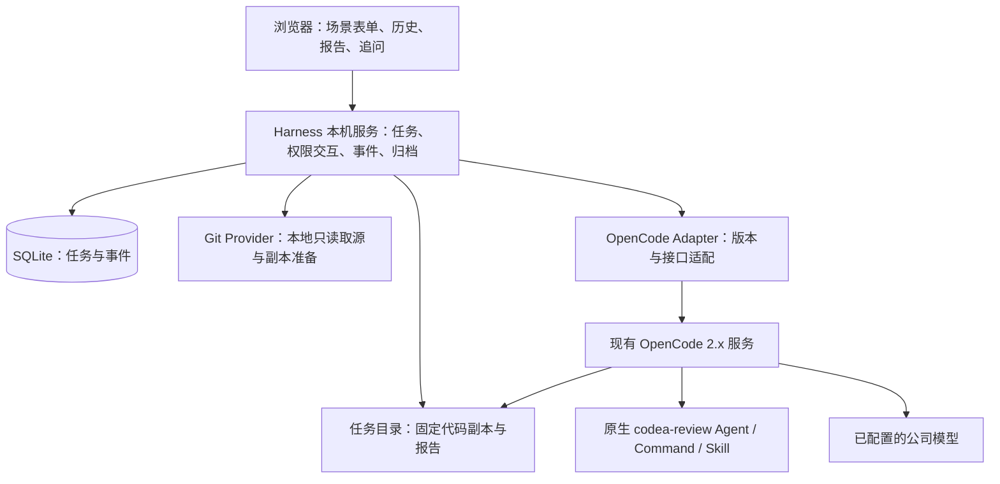

# Code Harness 场景化 Web 工作台设计

日期：2026-11-02｜版本：评审稿 0.1｜目标：Windows 本地单用户先验证，成熟后迁移服务器

## 1. 设计结论与依据

在现有 `lingyi9909/codea-harness` 仓库内新增独立的 `web-workbench/` 模块，复用 `codea-review/` 的 OpenCode 2.x 原生 Agent、Command、Skill 和报告模板。网页提供场景输入、执行进展、报告和追问；Harness 管理业务任务；OpenCode 继续负责模型与工具执行。

用户已明确：沿用现有 Code Harness；先在自己的 Windows 电脑运行，成熟后放服务器；代码使用 Git。尚未明确 GitHub/GitLab 等代码托管平台，因此首期不依赖 PR 接口。以下技术选型、阶段范围和容量数值是本稿建议，尚不是已通过实机验收的能力。

### 1.1 已检查的现状

本稿基于仓库 `main` 的 `58426663c69adc9bbd426d6a540767274ff9cf9a`。以下内容已读源码或文件核对：

| 已有资源 | 当前行为 | 本次处理 |
| --- | --- | --- |
| `codea-review/commands/codea-review.md` | 通过原生 Skill 启动 Review；支持 `--base` 与可选 Controller | Web 首轮调用同一命令，不另外实现审查推理 |
| `codea-review/agents/codea-reviewer.md` | 业务文件只读；动态 Git 查询 ask；允许写固定报告路径 | 保留既有权限；网页实现必要权限交互 |
| `codea-review/skills/codea-review/SKILL.md` | 当前工作区四层审查；仅本地 Git 查询；中高风险证据优先 | 不改变 TUI 用法；Web 在干净任务副本执行已提交范围 |
| `codea-review/skills/codea-review/references/report-template.md` | 五章中文 Markdown，HIGH/MEDIUM；不是结构化 JSON | 首版安全渲染原文，不强行解析成问题卡片 |
| 固定报告 `temp/codea-review-report.md` | 每次覆盖，没有任务历史隔离 | 只写任务副本；由后端按 Run 归档 |
| `.code-harness/tools-runtime/` | 旧版 Go Runtime 与既有安装/升级体系 | 首版 Web 不依赖旧 Go Runtime，不混淆两条执行路径 |

用户提供的单页汇报和同目录交互 Demo 表达了“选场景、填参数、查看过程与结果、继续追问”。Demo 使用模拟数据，不能直接作为真实执行、持久化或停止功能。

OpenCode 接口参考：本地已核对的公开 v2.0.27 源码提交 `1f4d07a4a519185955ae8ab2ea3607805509e386`，以及当前官方 v2 文档。公司实际 Windows 构建仍需接通验证；不能用当前在线文档推断所有 2.x 版本都兼容。

## 2. 路线比较

| 路线 | 收益 | 代价与适用性 |
| --- | --- | --- |
| 浏览器终端承载完整 TUI | 保留终端操作，适合熟练开发者远程使用 | 难自然呈现场景表单、报告历史和任务状态；PTY、重连和会话控制仍要开发 |
| **独立 Web + Harness 服务 + 原生 API，按需插件** | 可沿用 Demo 页面；现有审查能力不变；本地和服务器共用业务层 | 需要新增任务存储、事件适配和部署模块；本稿推荐 |
| 修改 OpenCode 客户端或深度依赖 GUI 扩展 | 与宿主界面结合更深 | GUI 接口标有 experimental；需承担宿主升级、打包与维护成本，首版收益不足 |

本稿沿用上一轮建议路线，按用户指定落在现有仓库。TUI 是可保留的客户端入口；Web 通过同一执行服务获取会话能力，不通过解析终端屏幕推断任务结果。首期无须开发 TUI/GUI 插件；确需自定义工具或结构化报告时，再增加 Server/RPC 插件。

## 3. 首期范围和成功标准

### 3.1 必须交付

- Windows 本机访问工作台，选择已登记的本地 Git 仓库。
- 显示当前 HEAD，选择本地已存在的基线分支或 remote-tracking ref。
- 审查固定的 `merge-base(base, head) → head` 已提交变更。
- 真实过程、权限请求、必要补充问题、停止、报告、追问和历史。
- 页面刷新、临时断网不会重复发起任务；后台数据可恢复。
- 在原业务仓库之外执行，原仓库 HEAD、index 和工作区不因任务改变。

### 3.2 明确的首期范围收敛

**首版 Web 只审查已提交变更。** 原仓库即使有 staged/unstaged/untracked，也不擅自暂存、提交或复制进任务。开始前持续显示：“本次分析已提交代码；未提交改动不包含在内”。有未提交改动时显示数量并允许继续，不要求用户为了使用平台先提交代码。

这一限制仅属于 Web MVP。现有 TUI `/codea-review` 的四层工作区语义不变。未提交代码快照的精确重建、分层证据和并发修改处理放到后续版本，不能直接把源码目录递给 Agent 后声称已经固定快照。

代码 Review 沿用已有 Java、Mapper XML、YML 关联上下文与 SQL 规则；不要宣传成任意语言完整支持。实际变更没有适用业务文件时，报告“不存在本场景可分析的变更”，不计为零风险审查成功。

### 3.3 首期不包含

PR 查询/评论、自动 fetch/pull、远程 Git URL 克隆、自动改码、提交/推送、生产排障、测试执行、团队协作、SSO、可视化工作流编辑器、浏览器完整终端、Windows/Linux 双平台生产认证。其他场景不放可点击的假入口。

## 4. 架构与职责



| 组件 | 负责 | 边界 |
| --- | --- | --- |
| Web | 表单、阶段、报告、对话、待处理交互 | 不持有模型密钥，不直连任意 OpenCode URL |
| Harness | 参数校验、任务与 Run、幂等、并发、归档、业务事件 | 不重新实现 Agent 循环，不伪造执行进度 |
| Git Provider | 登记仓库、解析 ref、固定对象、建立任务副本 | 所有 Git 子进程使用 argv；不改原仓库，不自动联网 |
| OpenCode Adapter | 会话、命令、消息、事件、表单、权限、中断 | SDK 与版本差异只在此层处理 |
| OpenCode | 实际模型、工具、会话、原生权限 | 不是业务多用户授权系统，也不是 OS 沙箱 |
| TeamAI | 已有能力资产版本与分发 | 首期不依赖其在线可用；启动任务记录实际资产摘要 |

## 5. 仓库内模块安排

建议新增以下目录。此处为设计目录，不表示已生成产品代码。

```text
codea-harness/
├── codea-review/                     # 复用现有原生能力
├── .code-harness/                    # 保留既有产品
├── web-workbench/                    # 新增，依赖与打包独立
│   ├── apps/web/                     # React + TypeScript 页面
│   ├── apps/server/                  # TypeScript 本机服务
│   ├── packages/contracts/           # 业务请求、事件、报告元数据
│   ├── packages/opencode-adapter/    # 固定版本客户端与恢复逻辑
│   ├── packages/git-provider/        # 本地 Git 与固定代码副本
│   ├── packages/storage/             # SQLite 与事务
│   ├── scenarios/code-review/        # 字段、执行绑定、成果定义
│   ├── scripts/windows/              # 启动、诊断、构建与卸载说明
│   └── tests/                        # 契约、集成与 Windows 实机验收
└── docs/superpowers/specs/           # 当前设计
```

不要在旧 Runtime 内加 HTTP Server，也不要让 Web 直接读写 `.code-harness/runs/` 来推断原生 Review 状态。Web 数据使用独立目录和版本。

## 6. Windows 运行与交付

建议默认数据目录 `%LOCALAPPDATA%\CodeHarness\Workbench\`，通过应用配置可改到独立磁盘。应用不得依赖开发者电脑中的绝对路径。

```text
Workbench/
├── config/                          # 仓库登记、执行服务连接；不放明文密钥
├── workbench.sqlite
├── tasks/<taskId>/repo/              # 独立 Git 副本
├── tasks/<taskId>/runs/<runId>/      # 本轮报告与证据
├── assets/<digest>/                 # 被选能力的版本副本或摘要
└── logs/                            # 脱敏诊断、轮转
```

开发环境使用公司允许的 Node.js LTS 和现有 OpenCode。锁定实际 Node、OpenCode、客户端依赖与 SQLite 驱动版本，Windows 干净机器验证后再发布。首个开发包可以依赖已安装 Node；面向使用者的本地试用包应包含已验证运行依赖，或在启动前一次性清楚列出缺项，不能运行时静默下载安装。

启动流程：检查 Git/OpenCode/Node → 检查数据目录 → 探测实际服务和认证 → 核对能力资源 → 启动 Harness 并打开本机页面。

- Harness 只绑定 loopback，静态页面与业务 API 同源。
- 启动口令/本机会话由服务端管理；修改操作校验 Origin 与 CSRF，避免仅以“localhost”作为授权。
- 优先发现并连接用户现有健康 OpenCode 服务，连接身份与版本从实际服务获取。
- 现有服务不存在时，只能按用户已配置的程序路径启动兼容服务，不替换公司二进制、不改默认 Build/Plan/Provider。
- 记录服务由谁启动。退出工作台不停止共享 OpenCode 服务，也不结束用户其他 TUI 会话。
- 关浏览器只断开显示；正在执行的任务继续。关闭 Harness 服务需提示仍在运行的任务并按中断流程处理。
- 睡眠/休眠后先恢复连接与核对状态，不能把客户端超时直接当作执行失败。

原生能力未安装时给出具体缺失项；已有同名配置摘要不一致时明确冲突，不自动覆盖。使用者只需现有 OpenCode 及工作台运行包；不要求安装旧版 Go Runtime、Maven 或 Docker。

## 7. 页面与交互

沿用用户提供的工作台风格，不另做一套界面语言。首期只开放代码 Review，其他场景在能力上线后出现。

### 7.1 工作台

左侧为工作台和任务历史，主区为一个紧凑输入区；不增加“新建任务”向导。Git 版将演示里的 PR 控件替换为基线分支选择。

| 字段 | 行为 |
| --- | --- |
| 代码仓库 | 已登记本地仓库下拉；显示名称和可展开完整路径 |
| 审查版本 | 只读显示当前分支、短 SHA；detached HEAD 直接显示 SHA |
| 基线分支 | 必填，从后端枚举的本地分支和 remote-tracking ref 选择 |
| 关注入口 | 可选 Controller 简名，沿用已有参数契约 |
| 补充要求 | 可选，最多 2,000 字符；只是关注方向，不能改变范围和权限 |
| 范围提示 | 固定展示“仅已提交变更”；有未提交内容时显示未纳入数量 |
| 主按钮 | 开始 Review；缺字段、资源未就绪时说明原因 |

首次使用可通过“添加本地仓库”输入本机文件夹，后端校验实际 Git 根目录并登记。普通任务请求只传 repositoryId，不接受任意 cwd、URL 或执行命令。服务器版把仓库登记限制为管理员或授权操作。

基线默认优先仍存在的最近选择；否则可建议 `origin/master`、`master` 或 `main`，但必须显示实际选中项。选项统一保存完整 ref 和解析后的 OID，不依据短名重新猜测；切换仓库清空基线。remote-tracking ref 只代表本地缓存，不代表远端最新。

点击启动时再次校验并固定源 HEAD 与基线 OID。若选择后版本变化，返回最新范围让用户重新发起，不静默替换这一次请求。无共同祖先、无已提交差异或无适用文件时，不进入模型执行。

### 7.2 任务详情

- 顶部：仓库、原始分支、基线、固定 SHA 和状态。
- 过程：真实阶段；工具细节可展开；不显示虚构百分比或思考链。
- 成果：一份完整五章 Markdown；支持展开阅读、复制和下载。
- 底部：基于同一固定版本追问；当前正在执行时保留草稿但禁止并发发送。
- 权限或补充问题：就地出现专用交互区，与普通追问分开。
- 停止：显示“正在停止”，实际中断确认后才显示“已停止”。

报告数量与严重级别首版不另造卡片计数。沿用 HIGH/MEDIUM 及中文模板，不把它们未经定义改成 P1/P2。代码链接打开平台已保存快照中的对应文件与有效行号；不自动指向原仓库当前工作区。

首版讨论引用使用选中文本或人工输入，不承诺自动提取任意 Markdown 中的 Finding ID。没有解析成功的结构化发现时，仍可正常阅读全文和追问。

## 8. Git 固定范围与代码副本

### 8.1 首版固定的对象

保存源仓库标识、原始分支/HEAD、完整 baseRef、baseOID、headOID、mergeBaseOID、对象格式、差异文件清单和能力摘要。Git Provider 所有只读状态查询使用 `--no-optional-locks`，禁用 fsmonitor、外部 diff 与 textconv 等非必要扩展。

前端只选择服务器枚举的 ref 标识；后端按完整 ref 解析为 commit。路径使用 canonical/real path 校验，拒绝仓库外路径、路径穿越和指向外部的 junction。未提交内容不进入复制流程，也不执行 stash/reset/checkout 于原仓库。

### 8.2 独立副本

每个 Task 使用自己的独立 Git 仓库，不使用会共享原仓库 Git 元数据的 linked worktree。快照准备属于 Harness 的确定性代码，不交给模型执行。

1. 从本地源只读复制所需 Git 对象，禁止 hardlink、alternates 和共享对象存储；不启动网络 fetch。
2. 副本核验保存的 base/head/merge-base 对象存在且一致；源 ref 后续移动不再影响任务。
3. 在副本建立固定本地别名 `harness-review-base` 指向保存的 baseOID，HEAD 固定到保存的 headOID。
4. 按 Git tree/blob 显式物化任务所需已跟踪文件；保留原始内容，禁止执行仓库 hooks、smudge/clean filter、构建脚本或子模块初始化。不能把“本地 clone”视为完全无副作用的 checkout。
5. 业务 `.opencode/`、兼容 Agent/Skill 配置和仓库内 `AGENTS.md` 等执行指令不物化到执行目录；可信能力来自已核对安装来源。配置类排除项写入 manifest；不因此宣称宿主已形成强制安全沙箱。
6. 敏感 `.env` 类文件不进入普通模型上下文；对为分析所必需且被排除的配置明确标注覆盖限制。副本 Git 对象仍属于受保护代码数据，不向前端开放任意 `git show` 接口。
7. 副本中的业务 index/worktree 应与保存的 head tree 一致；因过滤不物化的控制文件只属于显式覆盖排除，不得变成业务发现。

实现者可以选择经测试的本地对象复制方法，但必须证明没有网络、共享写入和隐式执行；不能只提供 clone 命令就跳过这些约束。检查源是否为 partial/promisor clone、shallow、含不支持的子模块、LFS 或 Windows 无法保真物化的符号链接；首版遇到影响本次分析的情况明确停止/说明，不自动补取或用指针文本冒充代码。对象复制与源仓库并发维护发生冲突则准备失败，可重新发起，不混用两份对象状态。

现有命令在干净业务副本中执行 `--base harness-review-base`，因此原生四层规则保留，但业务 STAGED/UNSTAGED/UNTRACKED 为空。页面额外显示原始 baseRef 与 OID，避免把内部别名当作用户原分支。

代码副本只作为可信本地用户的隔离工作目录。权限字符串、独立 Session、独立文件夹都不是操作系统级多租户沙箱；服务器上线另做 OS/容器与凭据隔离。

## 9. OpenCode 接入与扩展边界

### 9.1 兼容探针

每个获准的具体构建记录二进制/客户端版本、实际服务身份、认证方式及能力结果。必须验证：

- 服务身份与连接位置；不能只看 TUI 版本号。
- location 指向任务副本；会话选择预期的 codea-reviewer。
- 发现 Command、Skill 及模板的真实来源；同名项目配置没有覆盖。
- 会话创建、原生命令、历史消息、事件、状态、中断。
- 权限请求与表单的列表/回复/取消。
- session instruction entry 的结构化上下文能力。
- 原生持久 session log 是否可用，其序列与事件覆盖边界。

探针结果是“支持/不支持/待验证”，不得只检查版本号。依赖缺失时 UI 显示具体原因；不自动放宽权限或改装宿主。正式 Windows 包必须对目标公司构建做实测，公开 v2.0.27 源码不等于该公司构建。

### 9.2 首轮执行

1. 后端创建 Task/Run 和 outbox，固定仓库与资产元数据。
2. 获取单机执行槽，准备独立副本，订阅并建立可恢复事件收集。
3. 创建一个根 Session，确认 location、Agent、模型策略与权限。
4. 通过原生 instruction entry 注入带版本的任务上下文和补充要求；内容明确区分服务端范围与用户关注点，用户文本不能改变执行身份或权限。该步骤不得触发另一轮模型执行。
5. 调用原生 command：名称固定 `codea-review`，参数由后端生成 `--base harness-review-base`，可追加通过既有 ASCII Controller 契约的值。
6. `$ARGUMENTS`、Shell 占位符、自由文本均不承载用户补充要求。命令前处理存在版本差异，必须做恶意文本不会变成 Shell 执行的负向验证。
7. 跟踪真正执行终态；读取本轮新生成报告，核对模板五章与实际来源，归档后发布业务完成事件。

如果目标版本不支持 instruction entry，首版将补充要求字段禁用并说明，不用额外 prompt 偷偷启动第二轮，不把任意用户文本拼入命令。该降级必须在连接诊断中可见。

### 9.3 建议的适配层契约

以下是 Harness 自有抽象，不是宣称 SDK 存在这些同名方法。具体实现应调用固定版本生成客户端。

```typescript
interface OpenCodeAdapter {
  probe(): Promise<Capabilities>;
  createSession(binding: TaskBinding): Promise<SessionBinding>;
  putContext(binding: SessionBinding, value: TrustedTaskContext): Promise<void>;
  startReview(binding: SessionBinding, request: ReviewInvocation): Promise<AcceptedExecution>;
  discuss(binding: SessionBinding, request: DiscussionInput): Promise<AcceptedExecution>;
  inspect(binding: SessionBinding): Promise<ExecutionSnapshot>;
  readMessages(binding: SessionBinding, cursor?: string): Promise<MessagePage>;
  subscribe(binding: SessionBinding, cursor?: string): AsyncIterable<NativeEnvelope>;
  interrupt(binding: SessionBinding): Promise<void>;
  listInteractions(binding: SessionBinding): Promise<PendingInteraction[]>;
  answer(binding: SessionBinding, answer: InteractionAnswer): Promise<void>;
}
```

会话表单和 permission request 必须保存原生 ID 与业务 Task/Run 绑定。网页只能回答当前用户、当前有效轮次且仍待处理的请求；过期、已回答、重复回复均不转成新的执行。

保留动态 Git 查询原有 ask 行为。首版仅提供“本次允许/拒绝”，显示原生实际请求内容，不提供全局“始终允许 Shell”。这是工具权限请求，不是额外加一套常规业务审批流程。必要权限被拒时如实显示未完成/覆盖不足，不默认改用 Build 绕过。

### 9.4 TUI 与 Web

正常使用不需要 TUI 插件。工程师可在获准方式下查看同一 OpenCode 服务的会话用于排查。首版不支持 Web 与 TUI 同时向任务 Session 写入；后台若发现非本平台发起的执行或 Agent/配置改变，将本轮标记需复核，不自动把外部输出认作平台成果。

未来如需要 TUI 的“打开工作台”命令，可加轻量 TUI 入口；如需要类型化成果提交，可加 Server/RPC 插件。RPC 契约只是能力接口，不自动提供多用户授权、任务幂等或事件持久化。

## 10. 任务、执行轮次与状态

建议一个 Task 绑定一个固定代码快照与根 Session，Task 下有多个 Run。

Run 类型：`REVIEW` 首轮审查、`DISCUSS` 普通追问、`RECHECK` 明确复查、`RETRY` 失败后重试。普通追问只要求有效回答，不要求重写正式报告；复查生成新报告版本，失败不覆盖旧报告。

```text
QUEUED → PREPARING → RUNNING → COLLECTING → SUCCEEDED
                         ↕
                 WAITING_INPUT / WAITING_PERMISSION

任何非终态 → STOP_REQUESTED → STOPPED
任何执行阶段 → FAILED
接通状态不确定 → RECOVERING → 核对后回到真实状态
```

收到停止 HTTP 应答不等于已经停止；中断与完成竞争时采用引擎确认的真实终态。报告缺失/格式不完整时，REVIEW 不标成功；DISCUSS 无正式报告并不算失败。报告只有部分覆盖时明确标记，不与“未发现问题”合并。

首版所有仓库合计只运行一轮模型执行，其余排队；同 Task 不允许并发轮次。执行锁存数据库并带租约；服务重启先恢复核对原 Run，不因租约过期直接再启动一个。排队任务可取消，取消不创建 Session。

## 11. 数据与幂等

| 对象 | 关键字段 |
| --- | --- |
| Repository | id、显示名、canonicalPath、当前授权归属、状态 |
| Task | id、ownerId、scenarioId、scopeSnapshotId、sessionBinding、标题 |
| ScopeSnapshot | repositoryId、原 ref/OID、mergeBase、文件 manifest、排除项、代码副本标识 |
| Run | id、taskId、kind、status、operationId、nativeExecutionBinding、资产摘要、时间、错误 |
| Event | taskId、runId、seq、nativeEventId/原生序列、type、payload、createdAt |
| Message | 业务消息 ID、原生消息 ID、归属 Run、文本/附件引用 |
| Artifact | taskId、runId、version、kind、路径、sha256、范围和校验状态 |
| Interaction | taskId、runId、原生请求 ID、类型、待处理/已回答/过期 |
| Operation/Outbox | 用户动作 ID、内容摘要、发送阶段、原生受理信息 |

数据库至少约束 `(ownerId, operationId)` 唯一。同操作号不同参数返回冲突；相同参数返回已有任务。用户主动再次审查使用新操作号，不被错误去重。

创建任务与 outbox 在同一事务中提交；模型启动在事务外执行。浏览器请求超时先按 operationId 查询受理结果，不重新创建任务。

原生 command 不具备已确认的业务幂等键，不能把 HTTP 204 当作最终完成。出站请求超时或 Harness 在发送后崩溃时，标记“受理状态待核对”，根据绑定 Session 的 inbox、消息和持久事件确认；无法证明未受理则不自动重发。必要时结束为“执行状态未确定”，让用户明确新建重试，保留所有记录。

普通 prompt 若目标版本支持稳定消息 ID，则使用并保存该 ID；同样需要读取真实受理结果。所有网络请求失败都不能直接触发无限模型重试。

## 12. 事件与恢复

OpenCode 原生实时订阅是 live-only，断连不自动补历史；当前客户端文档明确没有自动重连与 replay。因此浏览器不能直接把原生订阅当作任务数据库。[客户端事件语义](https://dev.opencode.ai/v2/docs/build/client/)

Harness 收集事件并持久化为自己的业务序列。浏览器使用 Harness 的 SSE；每条持久事件带业务 seq，重连带最后序列并补齐，前端按 ID 去重。写数据库成功后才能发布“完成”事件。

| Harness 向浏览器的事件 | 数据来源 |
| --- | --- |
| `run.queued / preparing` | 调度器的实际状态 |
| `run.started / stopped / failed` | 引擎终态与后端核对结果 |
| `message.delta / completed` | 原生消息；delta 可批量落盘，完整消息为恢复依据 |
| `tool.started / completed` | 原生工具事件，摘要脱敏且有长度上限 |
| `interaction.pending / resolved` | 原生权限/表单请求 |
| `artifact.ready` | 本轮成果校验并归档成功 |
| `run.completed` | 执行结束且本轮所需成果收集完成 |

若目标构建支持 `/api/experimental/session/{sessionID}/log`，适配层保存其聚合序列并在断线后读取补偿；该 API 为 experimental，要锁版本验证，不能承诺覆盖全部瞬时 token 和工具输出。

若无持久日志：先订阅并缓冲，再读取会话状态、历史消息与待处理交互，合并去重后重新核对状态；后台定期对账。未能恢复的工具中间事件显示“部分过程记录缺失”，不能假造。可以恢复最终报告和完整消息，不等于所有实时过程都可回放。

## 13. 报告收集与追问

首版复用唯一五章 Markdown 模板。前端使用关闭原始 HTML 的安全渲染器，链接限定为获准协议；不执行代码块。任意文件下载都经任务归属和相对路径校验，不开放服务端任意文件读取。

报告只从本轮任务副本的固定路径读取。开始新的 REVIEW/RECHECK 前，归档既有成果并清除自己管理的旧报告候选；必须有本轮原生 write 成功记录以及终态后可读取的实际文件，才能认作本轮正式成果。已停止、仅模型声称写入、残留旧文件或其他会话写入都不算。

归档为 `tasks/<taskId>/runs/<runId>/review.md`，同时存 sha256、代码范围、Agent/Skill/模板版本、原生消息绑定。首版可下载 `.md`，不要求 HTML/PDF 导出。

模型输出完整报告但固定路径写入失败时，展示实际会话文本并提示保存失败，本轮成果状态为未完整完成；不得以旧文件补位。新轮次失败保留旧报告并注明所属轮次。

追问复用根 Session、固定副本与原报告版本；不能因为用户输入新路径/分支就切换范围。复查同一版本创建新 Run；检查最新代码需要新 Task。源仓库后来发生变化时显示“当前报告基于历史版本”，原报告证据仍指向任务副本。

原始模型 Markdown 是证据内容，不是后端指令。未来需要结构化发现时，通过新增明确版本的结果契约与插件提交接口实现；不在前端用正则猜任意 Markdown。

## 14. Harness 对外 API 草案

下表为新增 Harness API，不是 OpenCode API 的同名映射。

| 方法与路径 | 用途 |
| --- | --- |
| `GET /api/health` | 本机服务健康与已验证能力概览；不泄露密钥 |
| `GET /api/repositories` | 用户可使用的已登记仓库 |
| `POST /api/repositories` | 本地登记；路径归一化并限制可信根 |
| `GET /api/repositories/:id/refs` | ref 标识、完整名称、OID |
| `POST /api/review-previews` | 只读校验与返回 head/base/merge-base/范围/排除项 |
| `POST /api/tasks` | 携带 operationId 和已显示范围创建任务 |
| `GET /api/operations/:id` | 查询启动是否已受理 |
| `GET /api/tasks`、`GET /api/tasks/:id` | 历史与完整任务快照 |
| `GET /api/tasks/:id/events?after=seq` | 自有持久 SSE，补齐并订阅 |
| `POST /api/tasks/:id/messages` | 普通追问，带 operationId、报告版本引用 |
| `POST /api/tasks/:id/rechecks` | 明确复查同一快照 |
| `POST /api/runs/:id/stop` | 幂等停止请求 |
| `POST /api/runs/:id/retries` | 新操作号、新 Run；不覆盖旧轮次 |
| `GET /api/tasks/:id/interactions` | 当前有效权限与表单请求 |
| `POST /api/interactions/:id/answers` | 校验归属、版本和待处理状态后回复 |
| `GET /api/artifacts/:id`、`.../download` | 读取已归档成果 |

`POST /api/tasks` 中用户可传 repositoryId、baseRefId、expectedHeadOID、expectedBaseOID、可选 Controller、关注要求和 operationId。不能传 sessionID、模型密钥、任意命令、工作目录、插件地址或服务 URL。

错误需区分：参数错误、权限不足、版本变化、基线不存在、无共同祖先、不支持的仓库形态、能力资源缺失、模型连接失败、受理待核对、报告无效、中断失败。前端展示可操作原因，诊断详情带 requestId。

## 15. 场景扩展

场景定义使用声明式元数据与服务端执行绑定，不把用户可编辑 YAML 当成任意代码执行器。

```yaml
id: code-review
version: 1
inputSchema: local-git-review-v1
executor: opencode-native-command
command: codea-review
scope: committed-snapshot
artifact: codea-review-markdown-v1
writePolicy: report-only
```

新增场景需要同时交付：输入约束、可信上下文、Agent/Skill 版本、允许工具、真实阶段与终态、成果契约、停止恢复和验证样例。不能仅加一张场景卡片、拼一段 Prompt 就宣称接通。

| 顺序 | 场景 | 额外建设 |
| --- | --- | --- |
| P0 | 本地已提交代码 Review | 完成本文完整路径 |
| P1 | 当前工作区 Review | 保真固定 staged/unstaged/untracked；不能丢分层与原始行号 |
| P1 | 问题排查 | 授权日志/知识/环境来源、脱敏、问题证据与只读策略 |
| P2 | 测试用例设计 | 先只输出用例文档；测试运行是单独能力 |
| P2 | Bug 修复与测试执行 | 可写隔离目录、精确补丁确认、运行依赖、资源限制与回滚；单独评审 |
| P2 | PR 模式 | 明确托管平台后增加 provider，固定其真实差异语义和用户授权 |

## 16. 迁移到服务器

本地版保留 ownerId、RepositoryProvider、Executor、Storage 与 CredentialProvider 边界，但不提前搭建复杂微服务。

| 本机版本 | 服务器版本需要补齐 |
| --- | --- |
| 单用户本机会话 | 公司身份登录、会话失效、任务级授权与审计 |
| 本地仓库白名单 | 服务端获准仓库、用户代码权限与受控凭据 |
| 单执行槽 | 排队、公平限额、节点租约与故障恢复 |
| 同用户 OpenCode 服务 | 按用户/任务的运行身份、目录、配置、模型凭据和网络隔离 |
| SQLite 和本机成果目录 | 经迁移校验的 PostgreSQL、成果对象存储、备份和保留策略 |
| 单进程后台调度 | 可靠 worker；API 与 worker 可独立部署 |
| localhost | 内网 HTTPS、反向代理、SSE 超时与缓冲配置 |

首版本地已保存的绝对路径不能直接作为服务器路径使用。迁移历史任务主要保留报告、范围、消息与证据；旧 OpenCode Session 不能假设跨机直接续聊。只有成功迁移代码副本、会话与对应能力版本后才提供继续执行，否则历史只读，用户新建服务器任务。

Linux 服务器还需独立测试大小写、权限、路径、Git、依赖与公司 OpenCode 构建。此前“迁移 8–15 人日”为小范围服务器试用的估算，前提是身份/模型/仓库基础设施可复用；不能据此承诺生产多租户平台成本。

## 17. 分阶段研发与验收

以下为设计级交付阶段，不替代设计确认后的逐任务实施计划。

| 阶段 | 交付 | 退出条件 | 估算工作量 |
| --- | --- | --- | ---: |
| A 接通验证 | 公司 Windows、实际版本探针、真实 Git 样例、单轮 Review 与权限/中断 | 原生能力来源正确；真实报告可读；停止真实有效 | 5–8 人日 |
| B 可用本地版 | 沿用 Demo 页面，Git 表单、固定副本、历史、归档、追问 | 完整路径与原仓库不变验证通过 | 6–10 人日 |
| C 本地可靠性 | 幂等、崩溃待核对、刷新恢复、日志、运行包 | 断网/重启不重复发起，干净 Windows 机器验收 | 4–8 人日 |
| D 服务器试用 | 身份、授权、执行隔离、部署与数据迁移 | 不同用户互不可见/不可操作；故障恢复验证通过 | 另 8–15 人日 |

A–C 合计约 15–26 人日，属于基于当前认知的估算，阶段 A 后重新评估。代码副本与资源隔离若公司要求更高，或现有 API 无法兼容，要单列增量，不能压成“复制文件即可”。

### 17.1 必测用例

1. 干净 Windows 本机启动；中文/空格路径；端口占用；程序/能力缺失；私有模型异常。
2. main/master/develop、remote-tracking ref、detached HEAD、同名 ref、无共同祖先；起始/选择后 HEAD 变化。
3. 源仓库 staged/unstaged/untracked 继续保留，页面明确未纳入；源 HEAD/index/业务文件前后逐项不变。
4. 分析期间源仓库继续开发，任务证据仍对应固定 OID，不混读当前文件。
5. 代码副本无共享对象/hardlink，无 hooks/filter 执行；不支持的仓库形态明确失败。
6. 命令、Skill、模板真实来源正确；补充要求中的 Shell 文本不被前处理执行。
7. 动态 Git 查询 ask 在网页可见；拒绝/过期回复不会卡死或绕权限。
8. 原生表单回复、取消与过期；普通聊天不能冒充权限授权。
9. 连点、超时重试、受理后断连/崩溃不自动发起两轮。
10. 停止与完成竞争、取消排队、浏览器关闭、服务恢复与睡眠唤醒。
11. 旧报告残留、写入失败、模型声称完成、部分报告、无适用文件，均不冒充成功。
12. 普通追问不覆盖报告；复查失败保留旧报告；新代码需要新 Task。
13. SSE 重连补齐与去重；无原生持久日志时明确过程缺失，最终状态可对账。
14. 原始 HTML、危险链接、文件路径穿越、其他 Task ID、非法服务 URL 被拒绝。
15. 固定能力摘要与版本；旧 Go Runtime/原生 TUI Review/Commit 的既有流程不受 Web 模块影响。

使用真实 Git fixture、受控接口故障注入和模型替身验证确定性逻辑，再用公司真实模型走完整用户路径。模型替身、SDK 探针、UI 演示通过都不能替代最终 Windows + OpenCode + 私有模型验收。

## 18. 待实机确认及实现者可决定的事项

开工前需要阶段 A 验证：公司实际 OpenCode 二进制和服务身份；命令/Skill/模板来源；原生 session instruction、持久日志、表单与权限；本机模型连接；Windows Git 形态与实际仓库规模。以上是技术探针，不重复要求用户解释已经明确的页面方向。

实现者可在不改变本文行为的前提下选择：HTTP 框架、SQLite 驱动、组件细节、缓存批次、日志轮转、超时默认值。建议初始排队 20 项、单轮软超时 20 分钟、交互等待超时 15 分钟；均配置化。成果超过 30 天可提示用户清理，首版不自动删除历史报告、代码副本或 Session；只有可重新生成且未被活动任务使用的缓存可自动清理。超时先发中断并核对，不能只改数据库状态。删除历史需展示影响并由用户操作，不删除用户原仓库。

设计确认后，再拆分实施任务和测试顺序。本稿仅记录设计，不包含 Web 产品代码、运行包或实机接通结果。

独立可实施性复核结论：未发现仍需用户补充、且会改变实施计划的重要业务问题。公司实际 OpenCode 构建的任务目录绑定、可信能力加载及配置隔离应作为阶段 A 的前置探针与退出条件。

## 19. 参考资料

- 用户提供：`Code-Harness-工作台演示-单页汇报.pptx`；随附 Demo 与 `Code-Harness-最终设计方案.md`。其中页面方向可复用，PR 输入因本期只明确 Git 改为本地基线。
- 当前仓库：`codea-review/README.md`、原生 Agent/Command/Skill 与五章模板。
- [OpenCode v2 客户端](https://dev.opencode.ai/v2/docs/build/client/)
- [OpenCode v2 HTTP API](https://dev.opencode.ai/v2/docs/api)
- [Server/TUI/GUI/RPC 插件边界](https://dev.opencode.ai/v2/docs/build/plugins)
- [插件 RPC](https://dev.opencode.ai/v2/docs/build/plugins/rpc)
- [TUI 插件](https://dev.opencode.ai/v2/docs/build/plugins/cli/)
- [GUI 实验接口](https://dev.opencode.ai/v2/docs/build/plugins/gui/)
- [Git clone 的共享对象与本地复制语义](https://git-scm.com/docs/git-clone)

以上线上资料于 2026-11-02 核对。落地以锁定版本源码、契约和公司实测为准。
