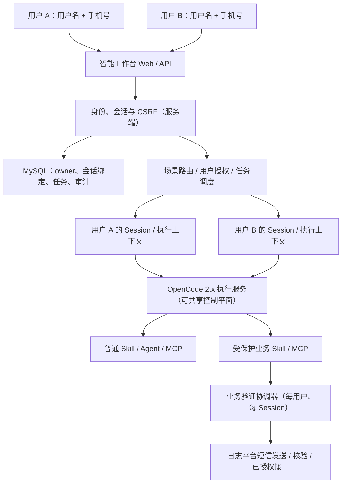

# 智能工作台 V1.1｜多用户隔离与业务 Skill 验证协同实施方案

> 状态：研发设计基线（待研发实施与内网验收），不是功能已完成声明  
> 仓库：`lingyi9909/codea-harness`  
> 方案基线：PR #110 的 `feature/smart-workbench-scenario-groups-20261115`，审核时 HEAD `25acb9186cd128265ae6269a0e7a006d61a763e1`  
> 方案分支：`docs/workbench-multi-user-skill-auth-20261117`  
> 环境：Windows 内网工作台、OpenCode 2.x、现有 TeamAI/Skill/MCP、MySQL 8.4（服务器多用户模式）；保留原本单机模式。

## 0. 决策与非目标（必须遵守）

1. **工作台登录仅输入用户名和手机号；手机号必填；不发送登录验证码，不新增登录验证码输入框。** 现有前端 `ProfileLogin.tsx` 已有这两个输入项，但其后端仍是单用户逻辑，不能等同于多人登录完成。
2. **短信验证码属于业务 Skill 访问目标系统的授权步骤，而不是工作台身份认证。** 例如日志平台的 Skill/MCP 调用日志平台发短信、等待当前操作人输入验证码、调用日志平台验证接口后，再由 OpenCode 继续分析；不用工作台自行开发一套登录短信服务。
3. 同一部署允许多用户并发登录与发起任务。聊天记录、任务、权限响应、执行状态、业务凭据、文件写入彼此隔离；用户 A 不能访问、删除、中断或批准用户 B 的资源。
4. 允许共享 **只读**场景定义、Agent/Skill/Command 定义及获准的知识内容；不允许共享用户身份上下文、验证码、Token、临时文件、会话历史或可写执行工作区。
5. 不改动目前问题排查（时间/traceId/msgSn/关键词）、历史重命名/删除、直接对话和数据分析的既有用户交互；不更换 OpenCode 2.x，不新增独立 Agent Runtime，不新增 Python 脚本。
6. **不把“仅凭用户名+手机号登录”表述成强身份验证。** 这是弱身份识别；知道他人姓名/手机号可能冒用。工作台登录不构成访问银行/日志/数据库等敏感系统的权限，业务系统必须独立执行其真实认证与授权。若安全审查禁止这种信任等级用于多人敏感环境，应阻止生产部署并提请产品方评估 SSO/其他可信身份来源，而不是私自加入登录验证码。
7. 本轮实现“多人工作台 + 业务验证协作接口/模拟器”；只有取得日志平台真实接口协议、Skill 实现和内网验收条件之后，才适配真实短信发送、验证码核验与业务 Token。不得伪造完成真实短信联调。

## 1. 当前实现核查（基于上述 commit）

| 模块/文件 | 目前事实 | 需要解决的问题 |
|---|---|---|
| `apps/web/src/ProfileLogin.tsx` | 用户名（现字段 `name`）、手机号已有前后端必填校验 | 需要用户身份稳定、登录失败提示与多人态 |
| `apps/server/src/auth.ts` | `LocalAuth.openLocal` 遇到不同 profile 返回 `PROFILE_IN_USE`；本地签发 `ownerId='local-workbench'`，token 存在进程 `Map` | 解除单用户门禁；改成用户绑定、可靠多会话及重启恢复；保留原单机逻辑 |
| `apps/server/src/local-profile.ts`、`.workbench/user.json` | 启动工作目录中只有一份用户资料；`app.ts` 会用文件内容核对登录会话 | 多人不能覆写共享 `user.json`；新模式不得用该文件推断“当前用户” |
| `apps/server/src/app.ts`、`start.ts` | `/api/v1/bootstrap` 在数据库模式仍使用 `ensureLocalOwner`；当前服务仅监听 `127.0.0.1`，校验 loopback Host/Origin | 不能简单开放监听或移除 Origin 校验；需新增受控服务器模式与身份上下文 |
| `packages/storage/migrations/001_init.sql` | 已有 `wh_owners`、`wh_tasks.owner_id`、`wh_operations.owner_id` 等；初始化只有单个执行 slot | 复用 owner 模型，追加用户资料、登录会话、聊天绑定等迁移；调度改进并发 |
| `apps/server/src/modules/chat/routes.ts` | OpenCode 创建时写 `metadata.harnessOwner`、`harnessScenario`；多数路径用 `owned` 检查；历史按 owner 和 scenario 过滤 | 当前所有本地用户仍同为一个 owner；扩展为 DB 归属强校验并全路由审计 |
| `apps/server/src/modules/chat/connection.ts` | 当前发现或启动的是一个共享 OpenCode Service | Session 隔离不代表执行工作目录/凭据隔离 |
| `apps/web/src/chatHistory.ts` 及各浏览器存储 | history key 主要按场景、目录、会话划分，缺 userId | 同浏览器切换登录身份可能残留旧用户标题、选中 Session、草稿/模型偏好 |
| `apps/server/src/scene-config.ts` | `config-access.json` 用用户名字符串配置编辑者，登录姓名并未验证 | 不能将可填写姓名当成可靠管理员权限凭据 |
| OpenCode 原生 Form/Permission 交互 | 工作台已有表单回复、权限确认和 SSE 会话事件通路 | 业务验证码需独立安全通路；不可将验证码明文落在聊天消息/模型上下文 |

## 2. 目标架构与边界



**隔离层次：**
- **UI/身份层**：Web 登录只是输入用户名、手机号，后端为每位用户解析稳定的 `userId/ownerId`。
- **数据层**：会话、任务、报告、历史、权限、SSE 全部检查 owner；前端隐藏不是授权手段。
- **执行层**：独立执行目录、临时文件、环境变量、文件读写权限、会话和授权凭据；共享服务不得导致可写目录串用。不能证明此层隔离时不得开放相关危险能力给多用户。
- **业务认证层**：日志 Skill 的验证码及访问令牌归属目标日志系统，不转化为工作台“已认证手机号”。

## 3. T1｜身份与登录（P0）

### 3.1 账号规则

- 登录项：`username`（显示/人员登记名，必填，长度 1～80）、`phone`（必填，按 E.164/业务支持规则规范化）；UI 沿用简洁登录页，**无验证码**。
- 用户由服务端生成稳定 UUID `userId`，在既有系统中映射 `wh_owners.id`，`ownerId = userId`。
- 手机号作为弱身份识别时的唯一账号键；同号再登录对应同一账号。已登记号码与新填写用户名不一致时拒绝或走明确管理员更新流程，不可悄悄把已有账号姓名覆盖。
- 用户名不参与会话所有权判断；手机号不得在聊天列表、错误日志、URL 或前端事件中明文传播。
- **安全声明**：这不是手机号所有权证明；不能声称足以抵御故意冒名。对敏感资源仍依赖业务系统独立认证与 ACL。

### 3.2 数据存储（追加版本迁移，不动 001）

建议版本化迁移（命名按实际迁移器约定，例如 `002_multi_user.sql`），至少包括：

| 数据对象 | 核心字段（示意） | 必须约束 |
|---|---|---|
| 复用 `wh_owners` | `id`、`subject`、`display_name` | 已有唯一 `subject`；老单机 owner 不复用为所有用户 |
| 新增 `wh_user_profiles` | `owner_id`、`username`、`phone_normalized`、`status`、创建/更新时间 | `owner_id` FK、手机号唯一索引、状态校验；手机号敏感字段需最小化访问与日志遮盖 |
| 新增 `wh_web_sessions` | `id`、`owner_id`、`token_digest`、`csrf_digest`、`expires_at`、`revoked_at` | 只保存 Token 摘要，可撤销；退出、超时、重启的行为确定 |
| 新增 `wh_chat_session_bindings` | `owner_id`、`service_identity`、`native_session_id`、`scenario`、`directory`、状态/时间戳 | 服务实例 + Session ID 唯一、owner FK、索引；与 OpenCode metadata 双重核验 |
| 可选 `wh_business_challenges` | `owner_id`、`native_session_id`、`challenge_id`、`target`、`expires_at`、状态 | **不存明文验证码/访问 Token**；过期清理和并发约束 |

要求：使用原有迁移工具，明确升级及回滚策略、备份/索引影响；不自动把旧 `local-workbench` 会话归到第一个新用户，旧数据默认只在原单机模式可见。若需迁移，由管理员显式映射并留审计。

### 3.3 服务端会话

- 多用户模式下禁止调用 `ensureLocalOwner()` 给所有人同一个身份；`bootstrap` 返回当前 Cookie 对应的真实用户。
- 支持同一个人多个标签页或浏览器会话及不同用户同时在线；不保留全局 `PROFILE_IN_USE` 限制。
- 用服务端可持久化的 session store（例如 MySQL），HttpOnly + SameSite Cookie、CSRF 验证、有效期、撤销和重启恢复；内网 TLS 终止下设置 `Secure`。
- 不在业务日志中输出手机号、Cookie、CSRF Token、验证码或业务访问凭据。
- 建议新接口（最终接口名由现有 contracts 约定决定）：
  - `POST /api/v1/auth/login`：`{username,phone}`，仅登记/识别并创建 Web Session，**没有验证码**。
  - `GET /api/v1/bootstrap`：通过 Cookie 返回本人 `userId`、显示名、权限与场景。
  - `DELETE /api/v1/auth/session`：仅注销当前会话并使其 SSE/操作失效。
- 全局状态不可通过“最后登录的手机号/用户名”推断当前请求身份；必须使用每个请求经验证的 Cookie。

## 4. T2｜用户资源隔离（P0）

**服务端所有读取/写入/删除/中断/审批行为都带 owner 约束**，不只是查询列表时加过滤：

| 对象/接口族 | 验收规则 |
|---|---|
| 聊天 `/chat/history` 和 `/chat/sessions` | 创建写 owner 绑定；查询、详情、重命名、删除只允许本人；他人 ID 返回统一不可见错误 |
| 消息/追问、模型切换、reasoning 翻译 | 会话归属验证后执行；不允许跨用户写入/访问 |
| `/chat/sessions/:id/activity` | SSE 订阅前认证 + owner 校验；登出/过期后主动关闭；不能接收别人的事件 |
| OpenCode Form / Permission / Interrupt | 只允许对应 owner 的当前会话；不能回应、批准、停止别人任务 |
| 代码审查任务/报告、附件、事件、文件下载 | 复核 `wh_tasks.owner_id` 及每个链路的 FK/关联权限，避免通过 taskId/runId 直取 |
| 用户偏好与浏览器状态 | localStorage/sessionStorage 的 history、selected session、草稿、排查条件、模型偏好都按 `userId + scene + directory + sessionId` 命名；切人后清理前台内存/订阅，防止闪现上个用户信息 |
| 配置写权限 | 旧 `config-access.json` 的明文用户名 ACL 不可作为多人模式可信管理员权限；改为管理员维护的 `userId/role` 授权，默认普通人只读 |
| 全局目录与知识 | 场景可以共享白名单绑定和只读知识；不可把前一用户正在使用的目录、文件、查询参数作为下一用户默认授权 |

绑定强制：`wh_chat_session_bindings` 是应用侧的 owner 真相来源；OpenCode 的 `metadata.harnessOwner` 作为一致性校验。创建原生 Session 成功但 DB 写入失败须标记不可见孤儿并补偿/清理，不能把未绑定会话放进历史列表。所有端点要覆盖“存在但属他人”及“记录已删除/归属不一致”测试。

## 5. T3｜OpenCode 多人执行与调度（P0）

### 5.1 最小正确的隔离单位

`ownerId → taskId → nativeSessionId → executionContext`，执行上下文至少包含工作区、读写权限、临时目录、工具权限范围、用户凭据作用域与停止控制柄。

- 允许多个用户并发读日志、跑不同排查、进行对话。每个会话独立追问、SSE、工具输出、完成/失败/取消状态。
- **不能只用同一个 OpenCode 服务的 Session ID 就声称 OS/文件权限隔离完成。** 对会写文件/修改 Git/运行 Shell 的任务，需要实际分离可写工作区（按用户或任务的 Git worktree/任务目录）及凭据。若共享同一操作系统权限导致互相可读写，则应隔离 OpenCode 执行进程/用户权限、容器或等效机制；无法保证前不得放开该能力。
- 只读日志/DB 查询也应绑定调用者的业务系统身份/授权凭据；不能用最近登录者的手机号或共用 Token。
- 继承现有只读 Git/SQL 安全策略；不通过禁用原生权限确认来“提升并发”。
- 单个任务异常不影响其他任务，停止 A 不中断 B；超时与并发上限配置可审计，排队/执行中/失败状态独立。
- 复查 `wh_executor_slots` 只有 `local-default` 槽位的限制：设计可控的多槽位/并发调度，避免交叉复用运行身份。默认上限保守、可配置。

### 5.2 部署

- **新增显式服务器多人模式**，与现有 Windows `--local-only` 单人入口并存；绝不把原有本机 profile 认证“放宽 Origin 检查”后直接暴露到局域网。
- 服务器模式推荐 TLS 反向代理、固定可信 Origin、明确反向代理/转发信任链、Secure Cookie、拒绝任意 Host、CSRF 校验；后端可保持监听 127.0.0.1，由代理对外。部署与安全参数必须有文档和自动测试。
- 需要 MySQL 时使用现有专用 MySQL 8.4 实例/库；不能拿业务数据库做测试。
- 原单人模式及旧会话仍按既有方式工作，不要求用户迁移后才能启动本地包。

## 6. T4｜当前用户信息如何安全地交给 Skill（P1）

**绝对不要在多人模式里继续用唯一的 `.workbench/user.json` 代表“当前用户”。** 它是所有人共享的，登录 A/B 切换会覆盖，极易把验证码发错人。

推荐引入服务端受信任的 `UserContextResolver`（接口名可调整）：

```text
resolveUserContext(authenticatedRequest, nativeSessionId, toolTarget)
  -> { ownerId, username, phoneNormalized, nativeSessionId, scenario, target }
```

- 每次 Tool/MCP 调用都通过服务端已验证 owner + session 绑定解析；**不允许大模型通过 prompt、环境变量或任意 Session ID 自行伪造身份**。
- 普通 Skill 默认不获得手机号；确实要向日志平台发短信的授权工具可按需获得手机号，返回给模型的手机号只展示脱敏形式。
- 用户上下文按 Session/调用生命周期注入，不用全局 `process.env`、共享文件、单例“当前用户”，也不把短信 Token 写入 OpenCode 对话或报告。
- 与 TeamAI 分发 Skill 的既有链路兼容；如果当前 OpenCode Skill 无法安全获得调用者上下文，必须通过受控 MCP/后端桥接实现，不能在多用户下读取共享 `user.json` 代替。

## 7. T5｜业务日志系统短信验证协作（P1；不用于登录）

场景示例：A 登录工作台 → 在公管问题排查输入 `msgSn` → OpenCode 调用日志 Skill → 日志系统要求对 A 手机号发短信 → A 在工作台安全输入验证码 → 日志系统核验成功 → OpenCode 继续查询、分析。

### 7.1 工具状态机

```text
NO_ACCESS
  -- logSkill.checkAccess --> AUTHORIZED | NEED_VERIFICATION
NEED_VERIFICATION
  -- logSkill.sendSms(owner-scoped phone) --> WAITING_CODE(challengeId,expiresAt,maskedPhone)
WAITING_CODE
  -- user enters code in protected UI --> VERIFYING
VERIFYING
  -- protected verifier submits code to log API -->
     AUTHORIZED(accessHandle bound to owner+target) | RETRYABLE_FAILURE | EXPIRED
AUTHORIZED
  -- logSkill.query(accessHandle,query) --> RESULTS
EXPIRED --> NEED_VERIFICATION
```

### 7.2 实施原则

- **模型负责编排**：“检测登录态 → 请求发送 → 发起等待 → 得到验证结果 → 继续调用查询”；**实际短信验证码只由日志平台验证接口验证**，不是语言模型自己判断数字是否正确。
- 工作台展示“已向尾号 **** 的手机号发送验证码”和输入框。验证码从受保护的 UI → 服务端校验桥接 → 日志平台验证工具；**不要让验证码进入普通聊天消息、模型 Prompt/Tool 可见的原始参数、OpenCode 持久消息、日志、SSE 或报告**。
- 如果原生 OpenCode 表单会把 answer 持久化或进入模型上下文，则不得直接用它传输验证码；需要新增独立、专用、短期存储的业务验证端点/控件，把模型可见结果限制为 `AUTHORIZED/FAILED/EXPIRED` 和不含秘密的 `challengeId`。
- 验证 challenge、访问句柄与当前 `ownerId + nativeSessionId + 目标系统` 强绑定，不得跨用户、跨任务、跨目标系统复用。服务端存短期句柄/加密凭据，模型不读取原始 Token。
- 已授权时跳过短信，失效时重新进入挑战；发送频率、验证次数、有效期、重放、并发挑战冲突均遵循业务平台策略并增加工作台防护。
- 这只是“验证协作框架”：发送方式、验证码长度、TTL、业务会话 Token/权限粒度，以**实际内网日志平台接口与现有 Skill**为准；未取得接口前用可控 Fake 实现做契约测试，不声称真实短信已经跑通。

### 7.3 建议抽象（接口待真实协议确认）

`BusinessVerificationBridge` 提供 `checkAccess`、`sendChallenge`、`submitCode`、`resolveAccessHandle`，适配具体日志平台 Skill/MCP；`BusinessChallengeUI` 提供当前会话专属验证码交互、过期/重发/取消。接口参数由服务端从 authenticated session 推导 owner，不允许客户端提交任意 ownerId/phone 代替。

## 8. T6｜验收矩阵（必须真实执行）

| 分类 | 测试 | 通过条件 |
|---|---|---|
| 账号 | 同手机号 + 同用户名再次登录；同手机号 + 不同用户名；不同人同时登录 | 同账号 stable ID；冲突有明确提示；A/B/C 同时在线 |
| 登录弱身份 | 无验证码字段/网络调用；姓名/手机号必填 | 登录无 SMS；不把它错误声明成可靠手机验证 |
| 会话恢复 | 关闭浏览器、刷新、服务端重启、退出重新登录 | 本人历史恢复；其他人数据不闪现；退出会话不可继续使用 |
| 授权 | A 直接请求 B 的 Session ID / taskId / runId / artifactId / SSE | 全部拒绝，不返回敏感内容；不可猜测存在性 |
| 会话操作 | A 重命名、删除、追问、中断、回复 Form/Permission；B 试图操作 A | 仅 owner 成功；失败不改变原始 OpenCode 状态 |
| 资源并发 | A/B 同时排查，C 同时 Review；A 中断/异常/退出 | B/C 继续运行且结果、文件、权限和提示词不串 |
| 文件隔离 | 不同用户使用同项目代码；写文件/生成报告 | 独立工作区或真实隔离；无跨用户写入和凭据泄露 |
| 浏览器切人 | 同一个浏览器依次 A→退出→B | localStorage/sessionStorage 中不显示 A 的对话标题、草稿、条件、偏好 |
| 配置权限 | 普通用户伪造管理员显示姓名 | 不取得管理权限；所有编辑由稳定 userId/role 判断 |
| Skill 用户上下文 | A/B 交错触发日志 Skill 发送短信 | A 的请求只使用 A 的手机号；B 的请求只使用 B 的手机号 |
| 日志认证 | 模拟 NEED_VERIFICATION→验证码正确/错误/超时/取消/重复提交 | 正确后续查，错误或过期不得继续；原始验证码/Token 不进消息与日志 |
| 旧版兼容 | 旧 `--local-only`、旧会话、PR #110 场景交互 | 不回归、不覆盖老会话、不修改现有表单流程 |

自动化：增加 MySQL migration、Fastify Auth/CSRF、OpenCode owner 越权、跨用户 SSE/工具、Windows Playwright 两浏览器并发、业务验证 Fake 契约测试。提供可重现的 Test ID、命令与脱敏结果。内网端到端验收由用户进行，不能以 CI Fake 代替公司日志系统真实认证。

## 9. 研发实施与阶段交付

| 阶段 | 交付范围 | 阶段门槛 |
|---|---|---|
| **P0-A / T1** | 数据迁移、唯一身份、用户名 + 手机号登录、会话/退出/重启 | A/B/C 同时在线；手机号必填；没有工作台登录短信 |
| **P0-B / T2** | 聊天/历史/任务/SSE/Form/Permission/下载的 owner 授权；浏览器存储切人隔离 | 所有跨用户读写测试通过 |
| **P0-C / T3** | OpenCode 并发、目录与凭据隔离、调度/中断、服务器代理安全 | A/B/C 并发真实执行互不影响；无法隔离的高风险能力默认禁用 |
| **P1-A / T4** | `UserContextResolver` + Skill/MCP 安全调用链 | 每次工具调用拿到正确用户；普通 Skill 不见手机号 |
| **P1-B / T5** | 业务短信协调器、UI、安全通道、Fake 日志系统；真实 Skill 适配条件说明 | 模拟成功/失败/过期/重试；验证码和 Token 无明文泄漏 |
| **P0-D / T6** | Windows 内网综合验证、部署/回滚文档、性能与安全验收记录 | 真实多人环境通过且由使用方验收 |

每阶段要求单独 commit、测试记录及独立审核；有阻断必须明确 FAIL/Conditional Pass，不能为了绿灯绕过权限测试。避免大规模改造前端视觉，只调整与多人身份有关的必要 UI。

## 10. 推荐文件改动与研发分支

建议研发从本方案分支创建 **`feature/workbench-multi-user-v1`**，切勿直接覆盖 PR #110。预计涉及：

- `apps/server/src/auth.ts`：将单机与多人 Auth 适配器分离，Session 持久化、身份解析。
- `apps/server/src/app.ts`、`start.ts`、`config.ts`：新增显式服务器运行模式，可信代理安全策略、Bootstrap 身份。
- `apps/server/src/local-profile.ts`：**旧单机模式保留**；多人模式不使用全局 user.json。
- `apps/server/src/modules/chat/{routes,connection}.ts`：用户归属、绑定、跨用户路由权限、执行上下文。
- `apps/server/src/scene-config.ts`：多人模式配置授权从用户名移到稳定 userId/role。
- `packages/storage/migrations/00x_multi_user.sql` 与存储访问层：身份、Web Session、Chat 绑定、业务 challenge。
- `apps/web/src/ProfileLogin.tsx`、`api/client.ts`、`chatHistory.ts`、各场景组件：登录、当前用户、切人缓存、状态。
- 专用 `BusinessVerificationBridge` + 验证 UI + 与原生表单并存的受控工具桥接；不独立开发短信网关。
- `tests/{api,ui,mysql}`：身份/权限/跨用户并发/模拟短信端到端回归。

**分支/PR 纪律：**本方案单独放在 `docs/workbench-multi-user-skill-auth-20261117`；研发基于其最新提交开 feature 分支，PR 先面向本方案基线审核。若 PR #110 尚未合并，需要保持依赖关系，勿把旧草稿代码直接合到 master；待前序分支合并后再 rebase/调整 PR base。

## 11. 提交给研发的验收材料

1. 架构与权限边界说明、关键流程图、数据库迁移和恢复策略。
2. 精确变更文件表、接口/contracts、启动/部署说明及多用户安全默认配置。
3. P0-A / P0-B / P0-C / P1-A / P1-B 每阶段 commit、PR、完整自动化日志。
4. 两浏览器三个用户的并发演示及越权测试；手机号/验证码/Token 的脱敏检查。
5. 真实内网日志平台尚不可接时明确标记 **“Fake/Mock 已验证；真实 Skill/网关待内网联调”**，不得宣称短信系统已上线。
6. 最终保留 PR #110 原有功能，具体由使用方完成 Windows 内网验收后决定是否合并。
